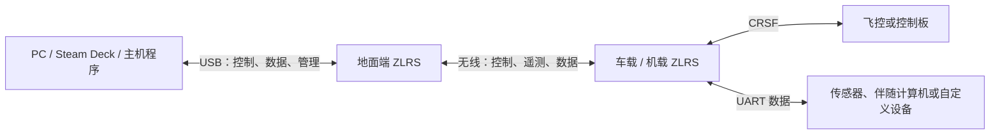

# ZLRS

ZLRS 是一套面向 DIY 飞行器、车辆和机器人项目的点对点无线串行链路。它用一对
小型设备把 **CRSF 控制与遥测**、**双向 UART 数据**和 **USB 主机接入**连接起来。

ZLRS 面向作者自己的 DIY RC 车、飞机，以及 DIY 四轴、FPV 和 PX4 生态硬件项目。它
适合不想被传统遥控器限制、希望用 PC、Steam Deck 或其他主机直接产生控制输入的项目。

## 用一对设备完成一套项目链路

地面端设备连接 PC、Steam Deck 或其他 USB 主机；车载或机载设备连接控制板和其他
串行设备。无线链路同时承载控制、遥测和数据。

PC 或主机程序负责读取摇杆、按键或其他输入，并发送 CRSF 控制帧。ZLRS 负责无线
传输；它不需要理解飞控的业务模型。飞控产生的电池、GPS、姿态等遥测通过 CRSF
端口进入 ZLRS，再由另一端转发给主机。ZLRS 自己产生链路统计，例如 RSSI、链路质量、
SNR、所用射频档位和发射功率。

## 三种使用方式

| 使用方式 | 适合的项目 | 业务组合 |
| --- | --- | --- |
| **CRSF 控制** | 需要实时操控和飞控遥测的车、飞机、四轴 | CRSF 控制 + 链路统计 + 外部 CRSF 遥测 |
| **数据透传** | 需要无线串口、传感器或伴随计算机通信的项目 | 双向可靠字节流 |
| **控制与数据并用** | 一套无线链路同时承担操控和项目数据 | CRSF 控制、遥测与双向字节流共享无线资源 |

主要部署是一对设备同时运行控制与数据。对于数据量较大、需要更高吞吐的项目，可以
使用两对设备：一对专门承担 CRSF，另一对专门承担数据。两对设备属于同一产品的
分工部署，使用相同的链路体系。

每台设备使用同一份固件，通过配置选择 TX 或 RX 角色。角色、工作模式和配对记录
保存在设备中，重启后继续使用。

## 控制与遥测

ZLRS 的 CRSF 端口保持标准 CRSF 的输入输出形式，用户可以把它连接到主机、飞控或
其他兼容控制器：

- 支持 16 个 11 bit 通道。
- CH1–CH4 是主控制通道，每个有效控制更新都会更新。
- CH5–CH16 是辅助通道。高速档位下，每个辅助通道目标为至少 50 Hz；它们适合飞行
  模式、灯光、挡位、云台、相机和其他比例或开关控制。
- ZLRS 提供链路状态信息，目标刷新率为 10 Hz。
- 飞控产生的业务遥测由 ZLRS 透明转发；ZLRS 不解释电池、GPS、姿态等内容。
- 所有通道保留 11 bit 精度；辅助通道可以通过较低更新率节省无线资源。

单 CRSF 模式的主控制更新目标是 1000 Hz。控制与数据并用时，主控制更新目标是
500 Hz，以便为数据留出固定无线资源。

## USB、UART 与管理

产品通过一个 USB-C 接口提供三个独立的 USB 虚拟串口：

| 虚拟串口 | 用途 |
| --- | --- |
| 控制 | 主机发送和接收 CRSF |
| 数据 | 主机使用双向字节流 |
| 管理 | 配置、状态、配对、升级和维护 |

CRSF 提供专用串行接口；数据提供独立的串行接口，数据波特率可配置。每组业务可以
独立使用 USB 或 UART，因此地面端可以使用 USB，车载端可以使用 UART，或反过来。
同一组业务未使用的接口不会与已使用的接口混成一条数据流。

管理接口用于配置、状态、配对、升级和维护。进入管理后无线业务暂停，管理操作完成
后恢复；管理期间到达的数据不进入业务队列。调试和引导加载器的专用接口属于开发与
升级流程。

## 无线性能策略

无线性能由控制更新率、空口速率、编码、功率、频段和数据负载共同决定。更高的控制
更新率可以降低响应等待并占用更多无线时间；更低的无线速率或更强的纠错可以增加
链路余量，但会减少可用吞吐并提高空口占用。降低更新率本身不会自动增加距离，只有
在此基础上采用更有利于灵敏度和链路预算的无线参数，距离才可能增加。

产品因此区分两个方向：

| 方向 | 优先级 | 产品目标 |
| --- | --- | --- |
| **高速** | 默认 | 使用每种业务组合允许的最快档位，优先低延迟和数据吞吐 |
| **远距** | 自动切换时 | 使用更大的链路余量，接受较低控制更新率和数据吞吐 |

设备默认使用最快档位：单 CRSF 的主控制目标为 1000 Hz，控制与数据并用时为 500 Hz。
产品不提供手动选档，也不支持运行中手动切档。

产品提供自动切换配置项。配置关闭时固定使用最快档；配置开启时，设备根据链路质量、
信号余量、丢包和控制更新间隔自动选择档位。自动切换由两端协调，并保持控制、遥测和
数据的明确行为。

## 可靠性与安全

控制链路需要稳定、可预测的时序，并在输入中断或无线失联时进入明确的保护状态。
数据链路面向可靠、有序且不重复的双向字节交付，具备重传、缓存和背压行为。

设备支持配对、会话认证、帧认证和防重放。无线功能使用认证与跳频；数据保密和各项
业务的加密覆盖范围由安全策略定义。安全设计见 [09-security](09-security.md)，协议
细节见 [08-protocol](08-protocol.md)。

## 硬件形态

产品硬件采用 RP2350 与单颗半双工 LR2021。设备通过 USB-C 供电、配置和维护；参考
载板提供 USB、按钮和两个串口。

硬件可以按项目需要使用：

- USB 作为 PC、Steam Deck 或伴随计算机的主机接口；
- CRSF UART 连接飞控、车载控制板或其他控制器；
- 数据 UART 连接 PX4 生态设备、传感器、伴随计算机或自定义外设；
- 同一固件在地面端和车载／机载端运行，通过配置选择角色。

PX4 是重要的兼容方向。ZLRS 关注标准 CRSF 和串行数据边界，具体支持的 PX4 控制板、
传感器和数据协议由兼容清单定义。

## 产品范围

产品支持 USB 主机、一对或两对 ZLRS、CRSF 控制／遥测和双向数据，并以最快无线档位
作为默认运行方式。产品需要具备稳定时序、可预测的控制交付、链路统计、可靠数据和
配置升级能力。

产品支持配置使能的自动选档、两对设备分工部署，以及面向 PX4、DIY 四轴、FPV 和飞机
的兼容。手动选档、手动运行中切档、Wi-Fi 和传统遥控器生态不属于产品方向。

接口和运行行为见 [07-firmware](07-firmware.md)，硬件接线见 [03-prototype](03-prototype.md)
和 [02-platform](02-platform.md)。
