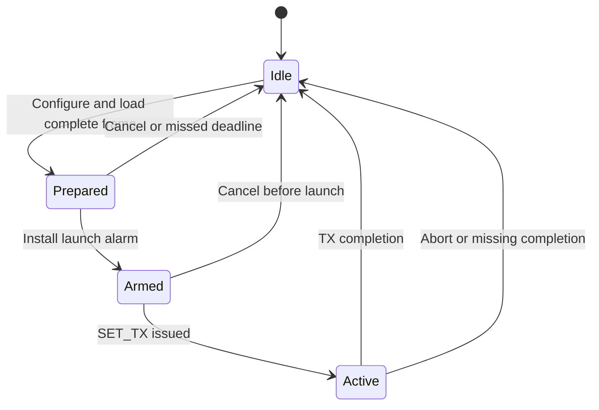

# Radio requirements

ZLRS uses one Semtech LR2021 in half-duplex FLRC or LoRa mode. SubG and 2.4 GHz share the
radio and cannot carry simultaneous DATA traffic. Module coverage, PA tables and
antenna paths are hardware constraints; the selected band supplies its modem and
channel plan.

Chip framing and electrical limits are referenced to the
[Semtech LR2021 datasheet, revision 1.1](https://www.mouser.com/pdfDocs/61979758LR2021_V1_1_datasheet.pdf).
The chip supports FLRC up to 2.6 Mbps and variable-length FLRC payloads of 6–511
bytes. Datasheet transition times are typical chip values, not the complete host
preparation budget.

## DATA modem profile

| Parameter | Requirement |
| --- | --- |
| Modulation | FLRC |
| Coding rate | 3/4 |
| Pulse shaping | BT 0.5 |
| Preamble | 24 bits |
| Hardware synchronization word | 32 bits, full-word matching |
| Physical CRC | 16 bits |
| Packet length | Variable, at most 511 software-frame bytes |
| DATA sync word | Four bytes derived from pairing material; hardware slot 1 |
| Pairing sync word | ASCII `ZLRS`; hardware slot 2 |

The operational raw-rate tiers are 2.6, 1.3, 0.65 and 0.325 Mbps. The default
2.4 GHz rate is 2.6 Mbps. The SubG rate is limited by the selected regional policy.
Physical coding, headers and control traffic reduce delivered user throughput;
raw bitrate is not serial throughput.

### Automatic 2.4 GHz profiles

Automatic mode uses the ordered profiles below before falling back to SubG.
Fixed-band mode retains its configured FLRC rate. SubG remains FLRC and follows
the selected regional rate and power policy.

| Profile ID | Modulation | Initial downgrade RSSI boundary |
| --- | --- | --- |
| 0 | FLRC 2.6 Mbps, CR 3/4 | -89 dBm |
| 1 | FLRC 650 kbps, CR 3/4 | -94 dBm |
| 2 | FLRC 325 kbps, CR 3/4 | -98 dBm |
| 3 | LoRa SF6, BW 1 MHz, CR 4/5 | -103 dBm |
| 4 | LoRa SF7, BW 1 MHz, CR 4/5 | -106 dBm |

These starting boundaries reserve approximately 10 dB over datasheet typical
sensitivity and require calibration with equal-length packets on real hardware.
LoRa uses a 12-symbol preamble, explicit header, physical CRC and normal IQ. Its
8-bit hardware sync word XORs the four pairing-derived sync bytes; software tags
continue to authenticate every frame. Profile ID 5 denotes fixed FLRC 1.3 Mbps
and is not an automatic fallback step.

Automatic mode caps every radio frame at 255 bytes, including FLRC and SubG.
The P1 DATA MTU is therefore 243 bytes (P0: 247). Keeping the same MTU across
all automatic profiles preserves a packet whose delivery ACK was lost: changing
its packet boundaries at a PHY transition could duplicate or omit user bytes.
Fixed FLRC retains its 511-byte frame limit. Slot reservations use the actual
mode's frame limit and modem airtime. The smaller automatic MTU trades some
peak throughput for safe transitions without discarding queued DATA.

| Region | Configured band limits | Raw-rate ceiling | TX ceiling | Duty policy |
| --- | --- | --- | --- | --- |
| FCC915 | 902–928 MHz | 2.6 Mbps | 22 dBm | No software duty cap |
| EU868 | 863–870 MHz | 0.325 Mbps | 14 dBm | 1% over 60 s |
| CN470 | 470–510 MHz | 0.325 Mbps | 17 dBm | No software duty cap |
| CN433 | 433.05–434.79 MHz | 0.325 Mbps | 10 dBm | No software duty cap |

These are ZLRS operating policies, not a certification claim. Region IDs are
defined in `include/zephyr/dt-bindings/zlrs/region.h`: FCC915 = 0, EU868 = 1,
CN470 = 2 and CN433 = 3. The board's `zlrs,radio` node declares `regions` as an
array of these IDs and chooses `default-region` from that array. The build rejects
an empty array, duplicate or unknown IDs, and a default outside the array.

`zlrs_region_get()` returns a plan only when its ID belongs to the compiled
`regions` array. RF initialization, settings writes and settings loading use this
same selection boundary. Unsupported writes fail without changing saved settings.
An unsupported saved region makes the stored settings invalid and follows the
[storage reset policy](06-firmware.md#persistent-storage-and-logs).
A full-band board lists all four IDs; application code selects plans by ID.

Each board declares minimum and maximum
transmit setpoints for both paths. The prototype range is −17 to +12 dBm on
2.4 GHz and −10 to +22 dBm on SubG. The effective SubG maximum is the smaller of
the board maximum and regional ceiling; the SubG region does not constrain the
2.4 GHz setpoint. Antenna gain and measured output require qualification on the
finished hardware. Power policy is specified in [firmware](06-firmware.md#automatic-band-operation-and-power).

## Transfer and timing contract

Commands and FIFO transfers use synchronous polling SPI. The RF owner resolves
accepted RX events, selects an operation and checks time, frame length and duty
budget before finalizing a transmit frame. Modulation, frequency, power and the
complete frame are prepared before the fixed transmit deadline.

A hardware timer launches the prepared SET_TX command 200 us after the slot
boundary. Ordinary SPI preparation and unbounded BUSY waits shall not run in IRQ
context. Preparation failure cancels that transmission; late transmission is not
allowed. TX FIFO receives the complete finalized frame in one load before launch.
Its contents remain fixed until transmission completes or the operation is
cancelled; payload bytes are not appended during transmission.

The preparation reservation is 1.6 ms on 2.4 GHz and 6 ms on SubG. Slot planning
also reserves 500 us for startup, the active mode's maximum packet airtime
(255 bytes in automatic mode, 511 in fixed FLRC) and 200 us for completion margin.
Airtime calculations use the same physical settings as the modem. Short packets
retain fixed slot boundaries and consume only their actual airtime.

### Radio operation lifecycle

RX runs Idle → Receiving → Idle on completion or its absolute close deadline.
The single radio owner permits one RX or TX job at a time. A preparation failure
leaves no launch armed. Missing IRQs close the operation at its original deadline.
The RX window close ends hardware waiting. A frame already received may finish
FIFO service and authentication during the next preparation reservation; its
acceptance budget ends before the next launch. The next TX independently checks
its remaining preparation and launch budget before finalization and arming.
Cancellation ends hardware references before packet memory can change. Lengths
are checked against buffer and FIFO capacity before access. FIFO errors,
underflow, transfer failure and missing completions produce failed transactions
with cleanup.

A local failure after a possible transmission does not prove that the peer
received nothing. The link retains the packet for confirmation or retransmission
with its DATA identity preserved. Best-effort DATA is released only on successful
local TX. The [air protocol](07-protocol.md#sequence-delivery-and-quality) defines
transmission sequences and ACK commitments.

Radio IRQs provide hardware timestamps; the RF owner performs protocol completion
and phase correction. Critical launch, timestamp and RF processing paths run from
SRAM. Retuning reserves a shared 12 ms frame-boundary interval as specified in the
[air protocol](07-protocol.md#automatic-band-switching).

### Preparation budget

The reservation covers the complete RX-to-TX critical path: RX IRQ service,
FIFO read, authentication, sink acceptance, operation selection, TX authentication,
modem setup, complete FIFO loading and alarm arming. Measure each stage and the
remaining launch margin under maximum packet sizes, duplex load, hash contention,
management activity and recovery. Separate steady-state observations from startup
and maintenance intervals; lifetime maxima alone do not establish the budget.

For automatic FLRC 2.6 Mbps with a 255-byte maximum frame, the period is
`3992 + 2 * preparation_us`. A 1600 us reservation gives a 7192 us period and an
ideal P1 user-data limit of about 33788 B/s per direction at a 243-byte MTU,
before control traffic and retries. A reservation must cover measured worst-case
work with margin. Both peers require identical timing; a runtime timing change
requires coordinated protocol behavior.

## Calibration and observation

Core2021 uses a crystal, DC/DC supply mode and the internal low-frequency RC
clock. Receiver boost is 7. SubG PA/current tables differ between LF and HF;
2.4 GHz uses the shared high-frequency path. Reference tables require module and
carrier calibration. The [board reference](../boards/zlrs/rp2350_zero_core2021/README.md)
specifies calibration frequencies.

Management status provides junction and XOSC-area temperatures, VBAT, version,
mode, command/reset status, IRQs and chip errors. Reads run with RF paused and
have independent validity flags. They describe the chip at the maintenance
boundary; they do not report ambient temperature or calibrated battery voltage.
FLRC does not provide LoRa SNR. See [management status](07-protocol.md#management-status)
and [acceptance](10-debug.md).
