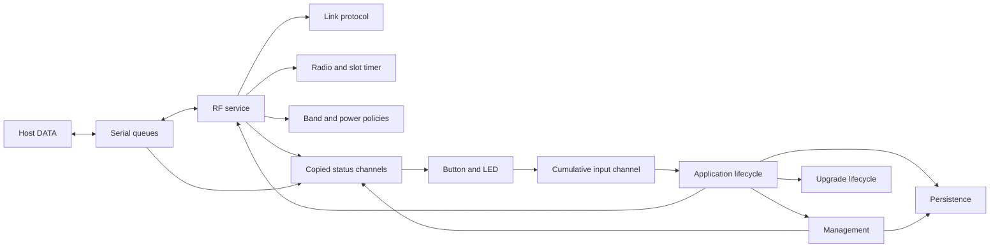
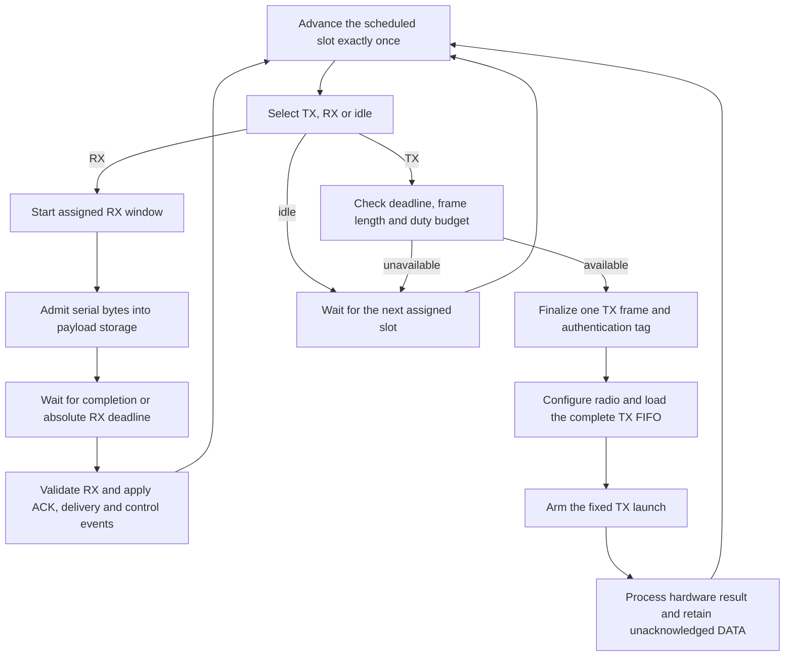

# Architecture

ZLRS exposes one transparent, bidirectional DATA stream over USB CDC or UART.
This specification defines ownership, execution boundaries and service contracts.
[Product](01-product.md) defines scope, [air protocol](07-protocol.md) defines wire
behavior and [firmware](06-firmware.md) defines operation.

## Service ownership

One LR2021 serves one active band and FLRC/LoRa profile. The RF service owns the
radio schedule, frequency/profile policy, phase, duty budget and power. The link service owns pairing,
sessions, authentication, replay contexts, ARQ and receive quality. Pairing,
sessions and DATA share one link context. Retuning changes radio parameters while
preserving that context's session and delivery progress.

| Service | Owned state and responsibility | Contract |
| --- | --- | --- |
| Application lifecycle | Initialization, pairing save, recovery | Call owner operations at frame boundaries |
| Persistence | Settings, identity, root key, pairing record | Validate and save; expose a snapshot of successfully stored values |
| Serial DATA | USB/UART endpoints, input/output queues, selection, drops | Supply bytes and accept complete received packets |
| USB device | Device configuration and bus availability | Supply host-presence observations independently of serial input or control lines |
| Management | Native MCUmgr groups, diagnostic schemas, maintenance session, export handles and timeout | Encode owner observations; complete cleanup before RF resumes |
| RF | Link context, hardware schedule, active band, phase, duty and power | Own all radio transactions and publish observations |
| Band policy | Quality history, dwell and probe decisions | Consume observations and request keep, planned transition or search |
| Power policy | Feedback history and transmit setpoint | Consume peer quality and bounds; return a bounded setpoint |
| User interface | Button sampling, long press, LED priority and cadence | Consume observations and publish cumulative input events |
| Upgrade lifecycle | Confirmation, deadline and recovery entry | Report confirmation only after its flash write succeeds |
| Log storage | Filesystem availability, file metadata and byte reads | Expose storage operations independently of management encoding |
| Application protocol | Wire encoding, pairing, sessions, FHSS, ARQ and replay | Zephyr application modules with explicit instances, time and transaction results |
| Hardware adaptation | SPI, FIFO, IRQ timestamps, timer, crypto, entropy and sensors | Return hardware results without owning protocol state |

Application lifecycle helpers live in `app/src/lifecycle.c`: image-confirmation
rollback and deferred pairing writes share the application-loop owner. The main
loop and management service use that interface. DATA admission, packet storage,
ARQ and packet retirement live together in `app/src/link/data.c`; packet bytes
and payload length have one owner. A submitted request retains its immutable wire
bytes until completion. Frame type and payload length come from those bytes and
the request size; radio reconfiguration is rejected while a transaction is active.
TX and RX submit through one internal radio-request implementation. Each link
mechanism declares its interface in its matching header; sibling modules include those interfaces directly. Plans fill caller-owned
destinations. Link, RF and persistence expose canonical read-only views within
their owning context. Cross-thread events own their values;
management responses are encoded by the preemptible SMP worker from an owned
snapshot captured at an application-owner boundary. Status and
diagnostic reports share management field encoding; host tools format the public
metrics for display.
Region rules and hopping channel parameters share one table and one ID set.
DATA decoding returns a borrowed view of the RX
buffer; the control-frame union contains no payload array. Test peers generate
wire input and drive the same reservation, finalization and completion interfaces
as RF. They do not add alternate production receive or queue paths.

RF builds the adopted link configuration once per modem change. Role, profile,
modulation, MTU and resynchronization interval are read from that configuration;
RF retains the slot clock and preparation deadlines it owns. Candidate modem
configuration and timing are built locally and adopted together after validation.
Current band mode and active band follow the adopted link configuration. Band policy
reads role, mode and PHY from the same configuration and retains only decision history.
Pairing deadlines are checked when advancing a slot. SHA digest and
peripheral reservation operations share `app/src/platform/sha256.h`.

Board descriptions define peripheral availability, electrical assignments and the
`zlrs,radio` node’s `regions` array. The region module owns the predefined plans
and restricts lookup to this compiled array. Persistence and RF use that same
lookup; board assembly and calibration own the hardware SKU.

All application C/C++ sources and tests use the Zephyr build. Link, frame
codec and region sources and their private headers live under `app/src/` and
compile directly into the application target through one unconditional source
list shared by the application and relevant test fixtures. Mandatory protocol
components have no feature switches. Driver availability follows devicetree and
the enabled Zephyr subsystem. Modules may use Zephyr APIs;
service ownership determines dependencies rather than an OS-portability layer.
Hardware drivers and shared USB/boot subsystems retain their Zephyr module
organization. Native Ztest fixtures and hardware images exercise the same
application sources.

## Execution and data flow

The main application thread owns link state and RF preparation/completion.
USB/UART interrupts and work queues transport bytes. Timer interrupts execute
prepared timing actions. Protocol handling, ordinary preparation, persistence and
UI rendering do not run in the timer interrupt. Radio IRQs, slot boundaries and
preparation deadlines notify the RF owner through one semaphore. A notification
only ends a wait: the owner checks the hardware completion, absolute deadline or
frame counter before progressing. Coalesced or unrelated notifications cannot
advance a frame or open its preparation window early.

The normal loop processes management entry, button requests, RF frames, pairing
persistence, status publication and the upgrade deadline. Initialization failure
must preserve available management and recovery interfaces while preventing
transmission.

Each TDD period has absolute A/B slot boundaries. A short packet cannot advance
the next slot. Preparation failure cannot authorize a late launch. Critical RF
and interrupt paths must execute from SRAM.

### DATA transactions

The RF owner processes the completed receive operation before selecting the
following transmit operation. RX-time work admits serial bytes into packet
payload storage. Header fields, transmission sequences, authentication and TX
FIFO contents are finalized at the assigned TX preparation opportunity.

A received ACK makes the next queued packet eligible. Without a matching ACK,
the retained packet is selected when retry is due. Startup and idle predecessors
use the same TX preparation path. Pairing, session messages, SYNC, DATA and empty
feedback share the finalize, prepare, arm and result lifecycle.

The link separates slot advancement, operation selection, frame finalization and
result handling. Each elapsed slot advances the shared frame/hopping schedule
once, including idle and skipped slots. Operation selection is read-only: repeated
inspection cannot consume sequences, seal payloads, generate nonces or alter the
schedule. State-machine events obtain handshake nonces before a proof is eligible;
entropy failure leaves that proof unavailable.

A slot context contains shared frame/slot identity, hop/channel selection,
protocol time, hardware launch target and close deadline. Protocol time and
hardware time remain distinct. Authenticated receive events supply the only
peer-driven changes to clock alignment. Selection and finalization execute in
one owner operation without an intervening RX or maintenance mutation.

| Component | Owned state and responsibility |
| --- | --- |
| Packet FIFO | Payload storage, writable tail, retained head and usable byte capacity |
| Link state machine | Pair/session state, ARQ, replay, accepted control events and receive quality |
| Frame codec | Wire layout, in-place DATA encoding and bounded receive views |
| TX attempt | One finalized frame, common sequence, immutable hardware reference and completion metadata |
| RF executor | Absolute slot deadlines, operation execution, duty and phase policy |
| LR2021 adapter | Modem setup, complete FIFO loading, launch and hardware results |

A TX attempt is finalized once from accepted protocol state. Its frame and metadata
remain immutable from hardware submission through completion or cancellation.
Diagnostics expose finalized attempts, TX authentication operations, complete FIFO
loads/bytes, cancellations and preparation-stage durations. Hardware preparation
and lifecycle details are specified in
[radio requirements](04-radio.md#transfer-and-timing-contract).

## Delivery and maintenance

The packet FIFO owns outbound user bytes until the peer acknowledges them. The
RF owner reserves writable space in the FIFO tail, copies serial input directly
into that space and commits only the bytes read. Each packet has aligned
contiguous storage with eight bytes of DATA headroom and space for its profile's
tag. The codec writes the header and tag in place; retransmissions preserve the
payload and DATA identity.

The head packet A holds the current unacknowledged payload. Its successor B can
receive additional user bytes while A waits for confirmation, and later packets
retain their FIFO order. B becomes A by changing indices after ACK. A packet is
sealed when selected for TX finalization, and its payload remains retained until
confirmation. Header and tag writes occur only when no hardware operation refers
to that packet. A small separate buffer holds control traffic; RX owns a separate
bounded buffer.

Static packet storage provides a 4096-byte user-data budget, including bytes
awaiting ACK, at production MTUs of at least 128 bytes. Smaller diagnostic MTUs
may reach the descriptor bound first. Slot width and descriptor capacity are derived from the pool MTU; no independent
layout cache is retained. The admission API reports usable space,
including both byte and descriptor limits. No heap allocation is used.

Serial output queues retain received bytes until the local host drains them.
The sink accepts an entire packet before the link advances its receive ACK.
USB and flow-controlled UART input backpressure propagate when finite queues
fill; unthrottled UART loss is counted. Best-effort DATA is released only after
successful local TX. Local preparation or launch failure retains user bytes and
allows another attempt at the next legal opportunity.

Management, pairing persistence, image confirmation and log synchronization
require a maintenance window at a frame boundary. The RF owner cancels pending
launches, ends hardware references and reports operation cancellation to the link
before storage or log work. Elapsed time advances the frame and hopping schedule
on resume. Management processes a complete session through one owner entry: pause RF,
flush logs, acknowledge entry, service commands, close exports and resume RF.
Explicit EXIT and inactivity timeout share cleanup; EXIT is acknowledged after
export cleanup.

Maintenance and band transitions preserve accepted DATA and unacknowledged
packets. A short management pause with no transition plan retains known radio
capture. A pause lasting at least the band's loss threshold, or one entered with
a pending transition, requires fresh capture and cancels the unexecuted plan.
Band/PHY transitions retain session keys, ARQ identities and packet order; the
next operation uses the selected radio parameters after the shared guard.

A session change preserves retained user bytes in FIFO order and assigns
session-specific DATA identities and authentication keys. Cross-session
exactly-once delivery is not guaranteed. Credential changes and factory reset
invalidate the affected active link.

## Persistence contract

| Persistent | Volatile |
| --- | --- |
| Role, band mode, region, profile, UART baud | Active modem, current power, duty budget, observations |
| Device identity, root key, peer ID, pairing salt | Session keys, replay baselines, ARQ and queues |

Missing records and flash errors are distinct outcomes. Persistence exposes one
read-only view of loaded settings and credentials, with validity flags for identity,
configuration and pairing. Every successful write updates its corresponding saved
value; a failed write must not claim success. Multi-record settings writes are not
a transaction.

Ordinary settings apply at boot. Root-key replacement, identity replacement,
pairing deletion and factory reset invalidate running credentials within the same
maintenance window. RF initializes a fresh link and adopts identity, root key and
pairing together from the saved view. Key derivation precedes the single initial
state transition; whether the link is configured is derived from that state. Persistence
itself does not operate RF or implicitly reboot.

A pairing result is saved only when different from the stored record. Save failure
allows retry. Deleting pairing clears the active result so it cannot be written
back. Storage geometry comes from the flash partition and erase granularity.

## State publication and UI

Cross-thread observations and button input use zbus copies. The service owner
remains authoritative; a channel is an observation, not shared mutable state.

| Channel | Publisher | Content |
| --- | --- | --- |
| RF | RF owner | Role, active band, mode, PHY, capture, transition, link, quality, power bounds, faults and dropped bytes |
| Serial | Serial service | Availability, selected endpoint, backpressure and dropped bytes |
| Management | Management service | Whether a management session is active |
| Input | UI | Cumulative long-press count |

Channels do not carry DATA bytes, keys, link pointers or command queues.
Notifications wake consumers; periodic reads recover missed notifications. Failed
publication is retried at a later boundary without blocking RF. A cumulative input
count preserves requests across notification coalescing; the application consumes
it in the owning context.

RF publishes when UI inputs change and retries failed publication at a later
boundary. Its event contains only the values needed by the UI and asynchronous
command validation. Management reads canonical owner views while RF is paused;
periodic hardware sampling does not publish a second copy of the full metrics.
Key fingerprints and handshake details are rendered only for explicit diagnostic
reports or maintenance logs.

One low-priority UI thread samples input every 20 ms and renders the LED at 20 Hz.
It releases channel locks before hardware output and writes only changed colors
or retries a failed write. UI output must not extend RF deadlines or feed the RF
watchdog. Priority and cadence are specified in [user interface](09-ux.md).

## Boundary validation

Radio completion reports status, length, RSSI and hardware time. RF passes the
result to the link and uses accepted protocol events for phase and contact
tracking. Invalid authentication, sequence or nonce must not move the clock.

DATA decoding produces small parsed fields and a const payload view into the
RX buffer. The view is valid only during synchronous receive processing. The
serial sink takes an owned copy before that buffer is reused. Control bodies use
bounded owned structures. Wire and persistent records use explicit bytes,
independent of compiler layout.

Length, version, CRC, local security profile, direction, context, authentication,
replay and FIFO bounds must pass before protocol effects are committed. Delivery
and secure randomness report success or failure. Entropy failure blocks handshake
proofs without a clock or ordinary pseudorandom fallback.

The TX authentication tag covers the final header followed by the retained
payload. RX-derived ACK and quality fields are resolved before authentication.
The hash engine is acquired within the remaining preparation budget; unavailable
hardware cancels the attempt without producing a tag. Once acquired, the compute
bound must fit the launch budget. Hardware failure cannot produce authentication
material that the protocol treats as valid. Hash-session ownership ends before
waiting for a radio operation.

Acceptance requirements are consolidated in
[development and acceptance](10-debug.md#data-transaction-acceptance).
