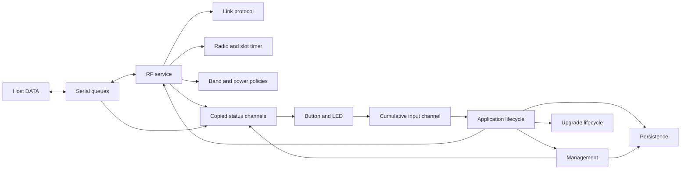
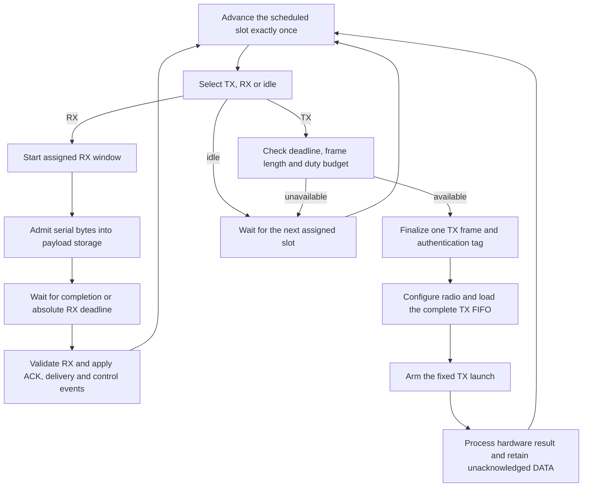

# Architecture

ZLRS exposes one transparent, bidirectional DATA stream over USB CDC or UART.
This specification defines ownership, execution boundaries and service contracts.
[Product](01-product.md) defines scope, [air protocol](07-protocol.md) defines wire
behavior and [firmware](06-firmware.md) defines operation.

## Service ownership

One LR2021 serves one active band and FLRC/LoRa profile. The RF service owns the
radio schedule, frequency/profile policy, phase, duty budget and power. The link service owns pairing,
sessions, authentication, replay contexts, ARQ and receive quality. Pairing,
sessions and DATA share one link context. Retuning changes radio parameters while
preserving that context's session and delivery progress.

| Service | Owned state and responsibility | Contract |
| --- | --- | --- |
| Application lifecycle | Initialization, maintenance windows, pairing save, recovery | Coordinate service operations at frame boundaries |
| Persistence | Settings, identity, root key, pairing record | Validate and save; expose a snapshot of successfully stored values |
| Serial DATA | USB/UART endpoints, input/output queues, selection, drops | Supply bytes and accept complete received packets |
| USB device | Device configuration and bus availability | Supply host-presence observations independently of serial input or control lines |
| Management | Native MCUmgr groups, maintenance session and timeout | Execute commands within an application-granted maintenance window |
| RF | Link context, hardware schedule, active band, phase, duty and power | Own all radio transactions and publish observations |
| Band policy | Quality history, dwell and probe decisions | Consume observations and request keep, planned transition or search |
| Power policy | Feedback history and transmit setpoint | Consume peer quality and bounds; return a bounded setpoint |
| User interface | Button sampling, long press, LED priority and cadence | Consume observations and publish cumulative input events |
| Upgrade lifecycle | Confirmation, deadline and recovery entry | Report confirmation only after its flash write succeeds |
| Log storage | Filesystem availability, file metadata and byte reads | Expose storage operations independently of management encoding |
| Diagnostics | Formatting of public observations | Read copied observations rather than another owner's mutable context |
| Application protocol | Wire encoding, pairing, sessions, FHSS, ARQ and replay | Zephyr application modules with explicit instances, time and transaction results |
| Hardware adaptation | SPI, FIFO, IRQ timestamps, timer, crypto, entropy and sensors | Return hardware results without owning protocol state |

Board descriptions define peripheral availability, electrical assignments and RF
coverage. Application services use those capabilities without branching on board
names. All application C/C++ sources and tests use the Zephyr build. Link, frame
codec and region sources and their private headers live under `app/src/` and
compile directly into the application target through one unconditional source
list shared by the application and relevant test fixtures. Mandatory protocol
components have no feature switches. Driver availability follows devicetree and
the enabled Zephyr subsystem. Modules may use Zephyr APIs;
service ownership determines dependencies rather than an OS-portability layer.
Hardware drivers and shared USB/boot subsystems retain their Zephyr module
organization. Native Ztest fixtures and hardware images exercise the same
application sources.

## Execution and data flow

The main application thread owns link state and RF preparation/completion.
USB/UART interrupts and work queues transport bytes. Timer interrupts execute
prepared timing actions. Protocol handling, ordinary preparation, persistence and
UI rendering do not run in the timer interrupt.

The normal loop processes management entry, button requests, RF frames, pairing
persistence, status publication and the upgrade deadline. Initialization failure
must preserve available management and recovery interfaces while preventing
transmission.

Each TDD period has absolute A/B slot boundaries. A short packet cannot advance
the next slot. Preparation failure cannot authorize a late launch. Critical RF
and interrupt paths must execute from SRAM.

### DATA transactions

The RF owner processes the completed receive operation before selecting the
following transmit operation. RX-time work admits serial bytes into packet
payload storage. Header fields, transmission sequences, authentication and TX
FIFO contents are finalized at the assigned TX preparation opportunity.

A received ACK makes the next queued packet eligible. Without a matching ACK,
the retained packet is selected when retry is due. Startup and idle predecessors
use the same TX preparation path. Pairing, session messages, SYNC, DATA and empty
feedback share the finalize, prepare, arm and result lifecycle.

The link separates slot advancement, operation selection, frame finalization and
result handling. Each elapsed slot advances the shared frame/hopping schedule
once, including idle and skipped slots. Operation selection is read-only: repeated
inspection cannot consume sequences, seal payloads, generate nonces or alter the
schedule. State-machine events obtain handshake nonces before a proof is eligible;
entropy failure leaves that proof unavailable.

A slot context contains shared frame/slot identity, hop/channel selection,
protocol time, hardware launch target and close deadline. Protocol time and
hardware time remain distinct. Authenticated receive events supply the only
peer-driven changes to clock alignment. Selection and finalization execute in
one owner operation without an intervening RX or maintenance mutation.

| Component | Owned state and responsibility |
| --- | --- |
| Packet FIFO | Payload storage, writable tail, retained head and usable byte capacity |
| Link state machine | Pair/session state, ARQ, replay, accepted control events and receive quality |
| Frame codec | Wire layout, in-place DATA encoding and bounded receive views |
| TX attempt | One finalized frame, common sequence, immutable hardware reference and completion metadata |
| RF executor | Absolute slot deadlines, operation execution, duty and phase policy |
| LR2021 adapter | Modem setup, complete FIFO loading, launch and hardware results |

A TX attempt is finalized once from accepted protocol state. Its frame and metadata
remain immutable from hardware submission through completion or cancellation.
Diagnostics expose finalized attempts, TX authentication operations, complete FIFO
loads/bytes, cancellations and preparation-stage durations. Hardware preparation
and lifecycle details are specified in
[radio requirements](04-radio.md#transfer-and-timing-contract).

## Delivery and maintenance

The packet FIFO owns outbound user bytes until the peer acknowledges them. The
RF owner reserves writable space in the FIFO tail, copies serial input directly
into that space and commits only the bytes read. Each packet has aligned
contiguous storage with eight bytes of DATA headroom and space for its profile's
tag. The codec writes the header and tag in place; retransmissions preserve the
payload and DATA identity.

The head packet A holds the current unacknowledged payload. Its successor B can
receive additional user bytes while A waits for confirmation, and later packets
retain their FIFO order. B becomes A by changing indices after ACK. A packet is
sealed when selected for TX finalization, and its payload remains retained until
confirmation. Header and tag writes occur only when no hardware operation refers
to that packet. A small separate buffer holds control traffic; RX owns a separate
bounded buffer.

Static packet storage provides a 4096-byte user-data budget, including bytes
awaiting ACK, at production MTUs of at least 128 bytes. Smaller diagnostic MTUs
may reach the descriptor bound first. The admission API reports usable space,
including both byte and descriptor limits. No heap allocation is used.

Serial output queues retain received bytes until the local host drains them.
The sink accepts an entire packet before the link advances its receive ACK.
USB and flow-controlled UART input backpressure propagate when finite queues
fill; unthrottled UART loss is counted. Best-effort DATA is released only after
successful local TX. Local preparation or launch failure retains user bytes and
allows another attempt at the next legal opportunity.

Management, pairing persistence, image confirmation and log synchronization
require a maintenance window at a frame boundary. The RF owner cancels pending
launches, ends hardware references and reports operation cancellation to the link
before storage or log work. Elapsed time advances the frame and hopping schedule
on resume.

Maintenance and band transitions preserve accepted DATA and unacknowledged
packets. A short management pause with no transition plan retains known radio
capture. A pause lasting at least the band's loss threshold, or one entered with
a pending transition, requires fresh capture and cancels the unexecuted plan.
Band/PHY transitions retain session keys, ARQ identities and packet order; the
next operation uses the selected radio parameters after the shared guard.

A session change preserves retained user bytes in FIFO order and assigns
session-specific DATA identities and authentication keys. Cross-session
exactly-once delivery is not guaranteed. Credential changes and factory reset
invalidate the affected active link.

## Persistence contract

| Persistent | Volatile |
| --- | --- |
| Role, band mode, region, profile, UART baud | Active modem, current power, duty budget, observations |
| Device identity, root key, peer ID, pairing salt | Session keys, replay baselines, ARQ and queues |

Missing records and flash errors are distinct outcomes. Reads return the loaded
snapshot and leave caller output unchanged when a value is absent. Every
successful write updates its corresponding saved value; a failed write must not
claim success. Multi-record settings writes are not a transaction.

Ordinary settings apply at boot. Root-key replacement, identity replacement,
pairing deletion and factory reset invalidate running credentials within the same
maintenance window. Persistence itself does not operate RF or implicitly reboot.

A pairing result is saved only when different from the stored record. Save failure
allows retry. Deleting pairing clears the active result so it cannot be written
back. Storage geometry comes from the flash partition and erase granularity.

## State publication and UI

Cross-thread observations and button input use zbus copies. The service owner
remains authoritative; a channel is an observation, not shared mutable state.

| Channel | Publisher | Content |
| --- | --- | --- |
| RF | RF owner | Role, active band, mode, capture, transition, link, quality, power, faults and radio observations |
| Serial | Serial service | Availability, selected endpoint, backpressure and dropped bytes |
| Management | Management service | Whether a management session is active |
| Input | UI | Cumulative long-press count |

Channels do not carry DATA bytes, keys, link pointers or command queues.
Notifications wake consumers; periodic reads recover missed notifications. Failed
publication is retried at a later boundary without blocking RF. A cumulative input
count preserves requests across notification coalescing; the application consumes
it in the owning context.

RF publishes on changes to LED inputs (role, link state, loss/fault, quality,
dropped bytes and initialization readiness), and refreshes the complete status at
least once per second. Management measurement refresh forces a publication.
Routine status uses lightweight link observations; key fingerprints and handshake
details are collected only for explicit diagnostic reports or maintenance logs.

One low-priority UI thread samples input every 20 ms and renders the LED at 20 Hz.
It releases channel locks before hardware output and writes only changed colors
or retries a failed write. UI output must not extend RF deadlines or feed the RF
watchdog. Priority and cadence are specified in [user interface](09-ux.md).

## Boundary validation

Radio completion reports status, length, RSSI and hardware time. RF passes the
result to the link and uses accepted protocol events for phase and contact
tracking. Invalid authentication, sequence or nonce must not move the clock.

DATA decoding produces small parsed fields and a const payload view into the
RX buffer. The view is valid only during synchronous receive processing. The
serial sink takes an owned copy before that buffer is reused. Control bodies use
bounded owned structures. Wire and persistent records use explicit bytes,
independent of compiler layout.

Length, version, CRC, local security profile, direction, context, authentication,
replay and FIFO bounds must pass before protocol effects are committed. Delivery
and secure randomness report success or failure. Entropy failure blocks handshake
proofs without a clock or ordinary pseudorandom fallback.

The TX authentication tag covers the final header followed by the retained
payload. RX-derived ACK and quality fields are resolved before authentication.
The hash engine is acquired within the remaining preparation budget; unavailable
hardware cancels the attempt without producing a tag. Once acquired, the compute
bound must fit the launch budget. Hardware failure cannot produce authentication
material that the protocol treats as valid. Hash-session ownership ends before
waiting for a radio operation.

Acceptance requirements are consolidated in
[development and acceptance](10-debug.md#data-transaction-acceptance).
