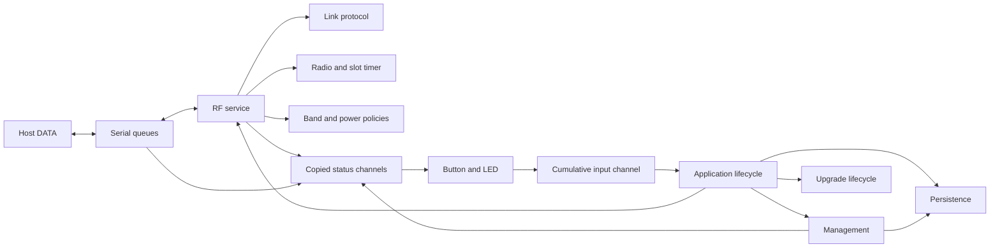

# Architecture

ZLRS exposes one transparent, bidirectional DATA stream over USB CDC or UART.
This specification defines ownership, execution boundaries and service contracts.
[Product](01-product.md) defines scope, [air protocol](07-protocol.md) defines wire
behavior and [firmware](06-firmware.md) defines operation.

## Service ownership

One LR2021 serves one active band and FLRC/LoRa profile. The RF service owns the
radio schedule, frequency/profile policy, phase, duty budget and power. The link service owns pairing,
sessions, authentication, replay contexts, ARQ and receive quality. Pairing,
sessions and DATA share one link context. Retuning changes radio parameters while
preserving that context's session and delivery progress.

| Service | Owned state and responsibility | Contract |
| --- | --- | --- |
| Application lifecycle | Initialization, maintenance windows, pairing save, recovery | Coordinate service operations at frame boundaries |
| Persistence | Settings, identity, root key, pairing record | Validate and save; expose a snapshot of successfully stored values |
| Serial DATA | USB/UART endpoints, input/output queues, selection, drops | Supply bytes and accept complete received packets |
| USB device | Device configuration and bus availability | Supply host-presence observations independently of serial input or control lines |
| Management | USB command framing, session, timeout and replies | Execute commands within an application-granted maintenance window |
| RF | Link context, hardware schedule, active band, phase, duty and power | Own all radio transactions and publish observations |
| Band policy | Quality history, dwell and probe decisions | Consume observations and request keep, planned transition or search |
| Power policy | Feedback history and transmit setpoint | Consume peer quality and bounds; return a bounded setpoint |
| User interface | Button sampling, long press, LED priority and cadence | Consume observations and publish cumulative input events |
| Upgrade lifecycle | Confirmation, deadline and recovery entry | Report confirmation only after its flash write succeeds |
| Log storage | Filesystem availability, file metadata and byte reads | Expose storage operations independently of management encoding |
| Diagnostics | Formatting of public observations | Read copied observations rather than another owner's mutable context |
| Protocol core | Wire encoding, pairing, sessions, FHSS, ARQ and replay | Pure C with explicit instances, time and transaction results |
| Hardware adaptation | SPI, FIFO, IRQ timestamps, timer, crypto, entropy and sensors | Return hardware results without owning protocol state |

Board descriptions define peripheral availability, electrical assignments and RF
coverage. Application services use those capabilities without branching on board
names. The protocol core shall remain independent of Zephyr, flash, zbus and
hardware drivers.

## Execution and data flow

The main application thread owns link state and RF preparation/completion.
USB/UART interrupts and work queues transport bytes. Timer interrupts execute
prepared timing actions. Protocol handling, ordinary preparation, persistence and
UI rendering do not run in the timer interrupt.

The normal loop processes management entry, button requests, RF frames, pairing
persistence, status publication and the upgrade deadline. Initialization failure
must preserve available management and recovery interfaces while preventing
transmission.

Each TDD period has absolute A/B slot boundaries. A short packet cannot advance
the next slot. Preparation failure cannot authorize a late launch. Critical RF
and interrupt paths must execute from SRAM.

## Delivery and maintenance

The link queue retains outbound bytes until the peer acknowledges them. Serial
output queues retain received bytes until the local host drains them. The local
sink must accept the entire packet before the link advances its receive ACK.
USB input backpressure propagates when finite queues fill; unthrottled UART
loss is counted.

Management, pairing persistence, image confirmation and log synchronization
require a maintenance window at a frame boundary. The window cancels pending
launches, ends hardware transactions and invalidates prepared packet encodings.
Elapsed time advances the frame and hopping schedule on resume.

Maintenance and band transitions preserve accepted DATA and unacknowledged
packets. A short management pause with no transition plan retains known radio
capture. A pause lasting at least the band's loss threshold, or one entered with
a pending transition, requires fresh capture and cancels the unexecuted plan.
Credential changes and factory reset invalidate the affected active link.

## Persistence contract

| Persistent | Volatile |
| --- | --- |
| Role, band mode, region, profile, UART baud | Active modem, current power, duty budget, observations |
| Device identity, root key, peer ID, pairing salt | Session keys, replay baselines, ARQ and queues |

Missing records and flash errors are distinct outcomes. Reads return the loaded
snapshot and leave caller output unchanged when a value is absent. Every
successful write updates its corresponding saved value; a failed write must not
claim success. Multi-record settings writes are not a transaction.

Ordinary settings apply at boot. Root-key replacement, identity replacement,
pairing deletion and factory reset invalidate running credentials within the same
maintenance window. Persistence itself does not operate RF or implicitly reboot.

A pairing result is saved only when different from the stored record. Save failure
allows retry. Deleting pairing clears the active result so it cannot be written
back. Storage geometry comes from the flash partition and erase granularity.

## State publication and UI

Cross-thread observations and button input use zbus copies. The service owner
remains authoritative; a channel is an observation, not shared mutable state.

| Channel | Publisher | Content |
| --- | --- | --- |
| RF | RF owner | Role, active band, mode, capture, transition, link, quality, power, faults and radio observations |
| Serial | Serial service | Availability, selected endpoint, backpressure and dropped bytes |
| Management | Management service | Whether a management session is active |
| Input | UI | Cumulative long-press count |

Channels do not carry DATA bytes, keys, link pointers or command queues.
Notifications wake consumers; periodic reads recover missed notifications. Failed
publication is retried at a later boundary without blocking RF. A cumulative input
count preserves requests across notification coalescing; the application consumes
it in the owning context.

RF publishes on changes to LED inputs (role, link state, loss/fault, quality,
dropped bytes and initialization readiness), and refreshes the complete status at
least once per second. Management measurement refresh forces a publication.
Routine status uses lightweight link observations; key fingerprints and handshake
details are collected only for explicit diagnostic reports or maintenance logs.

One low-priority UI thread samples input every 20 ms and renders the LED at 20 Hz.
It releases channel locks before hardware output and writes only changed colors
or retries a failed write. UI output must not extend RF deadlines or feed the RF
watchdog. Priority and cadence are specified in [user interface](09-ux.md).

## Boundary validation

Radio completion reports status, length, RSSI and hardware time. RF passes the
result to the link and uses accepted protocol events for phase and contact
tracking. Invalid authentication, sequence or nonce must not move the clock.

Delivery and secure randomness report success or failure. Entropy failure blocks
new handshake proofs without a clock or ordinary pseudorandom fallback. Wire and
persistent records use explicit bytes, independent of compiler layout.

Inputs require bounded length, version, CRC, authentication, direction, context,
replay and FIFO checks. A prepared packet must still match its session, frame
sequence, DATA identity and scheduled period. Its captured ACK may lag new
received DATA; that newer ACK remains pending until a later packet carries it.

Acceptance requirements are consolidated in [development and acceptance](10-debug.md).
