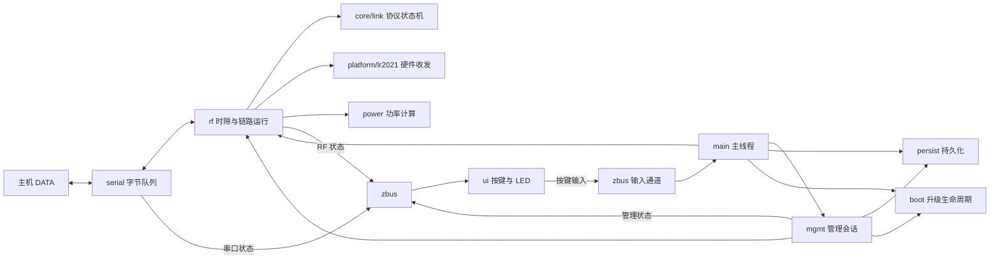

# 纯数传架构

本文描述当前源码的职责、数据归属和调用方式。本轮七项改造已完成，验证与提交进度列在文末。需求基线见[产品定义](01-product.md)，协议与设备操作分别见[空中协议](08-protocol.md)和[固件行为](07-firmware.md)。

## 需求边界

设备提供一条双向透明字节流，入口是 USB CDC 或 UART。保留配对、认证、会话、重放保护、ARQ、空闲质量反馈、动态调功、区域占空比限制、管理 CDC、升级回滚、日志、按键和 LED。

当前运行一个 FLRC DATA 链路实例，选择 2.4 GHz 或板载 sub-G 频段。普通参数保存后重启生效。动态功率、链路质量、会话和队列属于运行状态，不写入持久化配置。

未来的自动换频或双频运行，扩展点放在 RF 调度和双方协调协议中。串口字节流接口保持稳定；当前实现只承载已经可运行、可验证的频段选择。

## 组织方式

应用业务文件平铺；同一硬件适配目录保留多个真实硬件组件。文件名、职责和函数前缀对应，接口前缀与所属模块一致。

```text
app/src/
  main.c                 启动、应用循环、维护窗口、故障处理
  persist.c/.h           持久化参数、身份、配对记录、NVS
  serial.c/.h            DATA USB/UART、端口选择、队列和背压
  mgmt.c/.h              管理 CDC、会话、命令执行和应答
  rf.c/.h                DATA 链路实例、时隙、相位、射频运行策略
  ui.c/.h                一个线程处理按键和 LED，通过 zbus 交换状态与输入
  ui_pattern.c           纯函数计算 LED 颜色和节奏
  power.c/.h             纯 C 动态功率算法
  boot.c/.h              MCUboot 确认、回滚期限、进入恢复模式
  log.c/.h               日志存储和读取
  diagnostics.c/.h       调试报告格式化
  shell.c                调试 shell
  platform/
    lr2021.c/.h          LR2021 收发、FIFO、中断与精确定时发射
    slot_timer.c/.h      硬件时钟、绝对时隙边界、相位修正
    sha256.c             SHA 外设接入
    watchdog.c/.h        看门狗接入
    caps.h               devicetree 硬件属性与构建约束

core/
  proto/                 帧、认证算法、FHSS 序列、调制时长
  link/
    link.c               单个链路对象、状态转换、时隙决策、观察接口
    pairing.c            配对握手
    session.c            会话握手、SYNC 和同步
    data.c               DATA、ARQ、交付与质量反馈
    internal.h           上述实现文件共享的私有声明
  mgmt/                  管理帧解析与编码
  region/                频道、频段约束、功率上限、占空比计算

include/zlrs/            core 的公开类型和接口
drivers/                 Zephyr SHA/TRNG 驱动
subsys/usb/              应用与 MCUboot 共用的 USB 组合
subsys/bootguard/        MCUboot 看门狗保护
boards/                  硬件、引脚、频段和分区的定义
```

`core/link` 的文件按已有协议机制拆分，共用一个链路对象和一套对外 API。配对、会话、DATA 不再各自引入上下文、服务对象或回调表。观察接口放在 `link.c`。`ui_pattern.c` 保留为独立纯函数，便于直接验证显示规则。

硬件层继续使用已有 Zephyr API 和 Semtech 库。应用明确接入 LR2021；不增加通用 radio provider、存储 backend 或设备注册框架。

## 应用模块职责

| 模块 | 拥有的数据和职责 | 调用边界 |
| --- | --- | --- |
| `main` | 初始化结果、应用运行情况、维护窗口、配对结果落盘、按键请求处理。 | 直接编排各模块；提供实际应用流程，不汇总另一份全局设备状态。 |
| `persist` | 保存的设置、设备 ID、root key、配对记录及 NVS 布局。负责加载、默认值、保存项校验和写入。 | 不调用 RF、串口、UI；不拥有临时调节值、链路状态或发布通道。 |
| `serial` | 两个 DATA 端点、收发队列、活跃端口、溢出计数和 USB 背压。 | 提供读字节、接受整包、状态读取；发布串口状态，不认识配对、ARQ、功率或 NVS。 |
| `mgmt` | 管理端点、帧解析器、会话期限和待发送应答。执行明确的设备命令。 | 在主线程授予的维护窗口内调用 persist、RF、boot、log；发布管理状态，不私自嵌套暂停 RF。 |
| `rf` | 一个链路实例、运行频段、频道计划、帧时序、相位、占空比和功率控制状态。 | 启动参数由 main 传入；调用 core、serial、LR2021 和时隙时钟，发布 RF 状态并向主线程返回配对结果。 |
| `ui` | 按键去抖、长按识别、LED 优先级和节奏。 | 读取 zbus 状态、发布按键输入；不调用链路状态机、管理命令或 NVS。 |

`boot` 集中处理镜像确认、确认期限和恢复模式。确认命令在维护窗口内完成真正的 flash 写入，再报告成功，避免 ACK 成功与镜像确认失败分离。

`log` 返回日志文件信息和字节，使用正常的错误码。`mgmt` 在应答边界转换管理协议错误码，日志模块不依赖管理协议结构。日志写入由维护窗口安排。

`diagnostics` 接受 RF 提供的观察值并生成文本。调试 shell 通过 zbus 读取公开状态；完整链路、射频报告和已保存设置通过主线程在管理窗口采集，不跨线程遍历运行中的链路或持久化对象。

## 主线程与数据路径



主线程拥有所有协议与业务修改。USB/UART 中断和 workqueue 只搬运队列里的字节；硬件时隙中断执行已有的精确定时动作。一个低优先级 UI 线程按约 20 ms 周期采样按键，并按 LED 刷新周期渲染。

正常循环直接完成：检查管理和按键请求、执行一帧 RF、处理配对结果、安排所属模块发布状态、检查升级期限。主线程只是安排这些操作，不重新汇总模块状态。初始化失败时由同一主线程保持管理和恢复入口，RF 模块发布故障事实。

进入管理会话、保存新配对、确认镜像和落盘日志，都在帧边界暂停 RF。暂停时取消发射、结束硬件事务、丢弃预编码包；结束后恢复运行。维护窗口只由主线程流程安排，删除计数式的嵌套暂停。

时隙时钟继续使用绝对边界。RF 恢复时处理经过的帧和跳频进度，重新取当前时间；暂停前的时间戳不用于维护后的超时计算。DATA 每帧仍为 A、B 两个时隙，精确发射、提前构包和 FIFO 流水不变。

DATA 的发送队列和 ARQ 保留在链路中，串口队列只负责对接主机。收到的数据只有在 serial 接受整包后才改变 ACK；USB 堵塞时保持背压，UART 溢出如实计数。两个队列服务于不同的消费时机，不能仅因都是字节缓冲就合并。

## 持久化与运行状态

`persist.c/.h` 保存一个反映持久化数据的内存对象：

| 持久化内容 | 运行内容 |
| --- | --- |
| 选择的频段、角色、区域、安全 profile、UART 波特率、功率上限 | 本次启动采用的射频参数、实际功率、占空比预算 |
| 设备 ID、root key、peer ID、配对 salt | 派生会话密钥、帧序号、ARQ 序号、质量反馈和队列 |

同一个持久化对象可以包含参数、身份和配对记录；类型按字段含义分组即可。密钥不进入 zbus 状态或管理状态应答。这里的存储缺项标志只表示对应记录是否存在。

普通设置保存后重启生效；RF 在启动时取得运行所需的参数，并拥有随后变化的射频状态。运行功率与已保存功率上限有各自明确的含义。

NVS 的扇区大小取自存储分区所属 flash 节点的 `erase-block-size`，扇区数量由分区容量计算；应用不重复定义硬件擦除粒度。

主线程内可通过 `const persist_state_t *` 读取持久化对象；修改走保存操作，写入成功后才更新内存。对外接口使用设置结构、密钥和配对记录这些真实数据，不暴露 `(key, void *, size)` 存储接口。NVS ID、大小及字节编码留在实现文件里。

保存 root key、替换设备 ID、删除配对和恢复出厂后，由管理命令在同一个维护窗口明确更新或失效相应链路状态。需要重启才能采用的普通设置继续按原规则处理；不由 persist 隐式调用 RF。

配对完成后，主线程在维护窗口保存结果。保存失败必须反映为保存失败，不能将仅存在 RAM 中的配对报告为已持久化。真实 flash 错误和记录缺失分别处理，已有布局版本策略继续适用。

管理应答保持现有字段契约；在编码与工具展示处明确字段来自已保存参数还是实际运行参数。重构不额外增加一套配置消息或临时配置模式。

## 状态通信

保留 zbus，按数据归属使用四个通道。状态由所属模块维护，通道里的副本用于跨线程读取，不成为另一份可修改的业务状态。通道声明和消息类型留在所属模块的头文件，不新增集中式 bus 模块、全局状态对象或消息路由器。

| 通道 | 发布者 | 内容与消费者 |
| --- | --- | --- |
| RF 状态 | `rf`，主线程上下文 | 角色、运行频段和区域、链路状态、质量、实际功率、故障、链路丢字节等公开事实；UI 和 shell 读取。合并原 link、alerts 通道。 |
| 串口状态 | `serial`，主线程安排发布 | 可用性、活跃端口、背压和串口丢字节；UI 和 shell 读取。中断与 workqueue 只更新端点数据，发布时取得安全的副本。 |
| 管理状态 | `mgmt`，主线程上下文 | 管理会话是否进行中；UI 读取。 |
| 按键输入 | `ui` 线程 | 累计长按次数；主线程在帧边界处理配对请求。 |

RF 状态一次发布，避免 link 与 alerts 分开更新造成同一链路事实不一致。串口状态不塞入 RF 通道；串口丢字节与链路丢字节各有来源，UI 在呈现时合计。已保存设置由 persist 拥有，当前运行参数由 RF 拥有，管理命令在主线程读取所需值。

UI 读取各通道的最新值，通知用于唤醒，不要求每次状态变化都排队回放。周期刷新同时驱动显示节奏并补读状态；不同模块的通道不承诺一次全局原子更新。LED/GPIO 操作在通道读锁释放后执行。颜色、优先级和显示持续时间只属于 UI，不回传业务模块。

长按继续使用累计次数，消费者读取延迟或通知合并不会抹掉请求。主线程只在自己的执行上下文调用配对接口；不在 zbus listener 中运行配对、flash 或管理逻辑。调试 shell 请求管理会话保留管理模块自己的原子请求标志。

同线程的 DATA 交付、协议推进、配置保存和维护流程直接调用函数，字节队列继续使用 ring buffer。zbus 不承载 DATA 包、密钥、链路对象指针或逐条管理命令。

发布只在公开状态变化时进行，保留初次发布和必要的失败处理。RF 路径使用非阻塞发布，失败后的待发布值在后续帧边界重试；按键输入同样保留未发布的累计次数。消费者依靠最新状态和周期读取恢复通知遗漏，不建立通用重试框架。重构时区分通道写入失败与观察者通知失败，不把通知成功当作业务操作完成。

## 协议、硬件和策略的边界

`core/link` 保留纯 C、显式链路实例和同步调用方式，能够在 host 上运行两个节点。它拥有配对、会话、帧序号、同步跳频进度、ARQ 和接收质量；不访问硬件、不写 flash、不决定 LED 表现。

`core/mgmt` 仅负责 SOF、版本、长度、CRC 和管理帧编码。业务参数在应用 mgmt 的命令处理中解码，保存项的合法性在 persist 的共同规则中校验。命令执行在应用的直接 switch 中可见。

LR2021 适配层只知道硬件请求、收发缓冲及结果，返回状态、长度、RSSI 和时刻等信息。RF 将结果交给 `zlrs_link_complete()`。定时器 ISR 继续只执行可在该上下文运行的精确动作，不运行协议或持久化逻辑。

`power` 使用显式小型状态对象，输入 peer feedback、真实反馈时刻、当前时刻、上下限，返回功率设定值。阈值、步长和保持时间直接定义为当前产品参数；动态状态只保留计数和时刻。它不包含 Zephyr、日志或链路对象；RF 负责应用结果。

现有 `on_data` 回调有实际语义：交付是否成功决定 ARQ 确认。随机数入口也支持硬件与模拟的真实差异。这两种接口保留。单一应用流程直接调用。

当前只包含单域 FHSS、两个频段的 FLRC 参数、频道表和区域约束。第三方射频库保持原样。未来自动换频扩展 RF 的选择策略和双方协调协议；双频运行按实际硬件与协议需求安排调度。

## 类型、校验和错误处理

内部角色、频段、区域、profile、链路状态使用所属模块的 enum 类型。枚举转字节只出现在协议编解码和 NVS 序列化处；C 结构体不直接作为 wire 或 flash 格式。类型放在拥有该概念的头文件，避免新增集中式 `types.h`。

外部输入的帧长度、版本、CRC、认证、重放、FIFO 长度、串口容量和实际时限都保留检查。预编码包必须仍属于当前会话和发送序号，失效时重新构包。RX 期间预装入 FIFO 的包保留当时的 ACK 快照；之后收到新 DATA 时保留待确认状态，由下一个 DATA/反馈包补送 ACK，不将尚未发出的确认视为完成。持久化参数在加载和修改入口采用同一套合法性规则，发射功率与占空比在实际发射边界执行限制。

内部调用具有固定约定的指针、必需回调和初始化顺序不逐层重复检查；程序错误通过断言或明确调用约定暴露。硬件、flash、主机拥塞这些真实可失败操作继续返回可解释的结果，不吞掉错误，不自动伪造成正常值。

辅助函数只用于收敛实际语义。例如 NVS 的“写入字节数”和“内容未变化返回 0”都代表成功，需要统一处理。存储可用性只在加载入口检查，记录读取直接调用 NVS。

普通 C 结构体可能有 padding，不能把整块 `memcmp` 作为通用的值比较。删除重复状态后多数比较自然消失；仍需比较的设置按字段比较。明确的字节记录、ID、密钥和配对 salt 可以直接比较。

## 落地顺序

每项完成相应模拟与实机验证后独立 commit，再进行下一项。重构优先保持空中协议 `8`、管理协议 `4`、NVS 布局及现有命令语义；不因移动目录或调整 enum 内存表示改变字节格式。

文件迁移同步更新 CMake、Kconfig、测试、架构检查脚本和文档引用。拆分 RF 与 core/link 时同步更新 SRAM 代码重定位，保持精确时序路径的运行位置。

| 顺序 | 修改项 | 验证重点 |
| --- | --- | --- |
| 1 | 将应用循环收回 main；RF 改为单帧执行；合并升级/恢复到 boot，删除 runtime hooks 和无调用重启 API。 | 双节点模拟、实机双向 DATA、管理进入/退出、确认与未确认回滚、初始化失败的管理可达性。 |
| 2 | 保留 zbus，合并 RF 的 link/alerts；按发布者整理公开消息；合并按键和 LED 线程，保留累计长按和必要发布重试。 | 状态消息、LED 规则与长按模拟；实机状态显示、配对请求、管理显示、RF 时序受影响情况。 |
| 3 | 合并 persist；清理设置副本和 config 通道；改用领域类型和明确的存储序列化；取消 persist 对 RF 的调用。 | 模拟 NVS；当前记录格式读取；实机设置、身份/密钥操作、配对持久化、重启及恢复出厂。 |
| 4 | core/mgmt 收缩为帧编解码；应用直接处理命令；日志摆脱管理协议类型。 | 帧与畸形输入模拟；命令处理模拟；实机全部命令、错误应答、日志、升级工具兼容性。 |
| 5 | LR2021 适配返回硬件结果，协议完成处理归 RF。 | 射频结果处理模拟；两频段实机传输、丢包恢复、FIFO 错误和精确发射时序。 |
| 6 | 提取纯 C 调功算法，使用链路已有的反馈值与时刻。 | 阈值、保持、上下限、失反馈模拟；两端实机调功与断反馈回退。 |
| 7 | 按协议机制整理 core/link，删除未启用的调度路径，清理头文件和调试观察接口。 | 双节点模拟、认证/重放/ARQ/背压；两频段实机 DATA 与重连；协议和存储字节格式不变。 |

架构完成的标准是：一个应用主循环、一个 DATA 链路对象、一个持久化数据对象、一个 UI 线程；各模块只有明确的数据和调用边界。同线程业务直接调用，跨线程状态与按键输入通过 zbus；没有双向持久化/RF 依赖、通用业务 callback 表或额外的全局状态汇总层。主机模拟仍能覆盖真实协议行为，实机仍保有数传、sub-G、调功和维护能力。

## 验证与提交进度

七项改造均已完成相应验证并独立提交。TX 手动 reset 后 USB 已恢复，两端镜像、身份、配对及原设置已核对。

| 修改项 | 模拟与构建 | 实机结果 |
| --- | --- | --- |
| 5：硬件结果与协议完成分离 | host sanitizer、RF 双角色模拟、LF/HF 构建、SRAM 位置检查通过。 | 两频段双向 DATA、管理暂停与重启重连通过；两轮双向 262145 字节满帧及原始收发通过，FIFO 错误与下溢为 0，最大发射抖动 3 µs。 |
| 6：RF 拥有调功状态 | 阈值、保持、上下限、重复与过期反馈、时钟回绕及 RF 模拟通过。 | 两频段两端均从 10 降至 7 dBm；暂停任一端的管理会话后，对端回退至 10 dBm，恢复后 DATA 完整。 |
| 7：协议机制拆分与无用路径清理 | host ASan/UBSan、双角色 × 双频段 RF 模拟及 application/settings/mgmt/UI 模拟通过；工具 41 项测试、LF/HF 构建、架构检查与十个关键函数的 SRAM 位置检查通过。200 包 wire 回归序列与重构前一致。 | 新旧固件双向互通；两频段各两轮双向 8192 字节完整，管理暂停与重启重连通过；两板四类报告及错误参数检查通过。最终两轮双向 262145 字节满帧完整，FIFO 错误、下溢和芯片错误为 0，最大发射抖动 3 µs；测试后回滚至已确认的最终镜像。 |

两板最终保留原身份、配对及 2.4 GHz / CN433 / P1 / 115200 baud / −10 dBm 设置，连接正常。实机使用 LF 板验证两个频段，HF 仅完成构建。

额外连续身份检查此前在 RX 上复现 `STORE`；夹具恢复原 NVS 与固件，随后完整重跑（含十次身份生成和恢复出厂）通过。首次失败记录保留，间歇错误的具体来源尚未定位。物理按键和 LED 颜色未人工观察。测试入口见[开发与调试](11-debug.md)。
