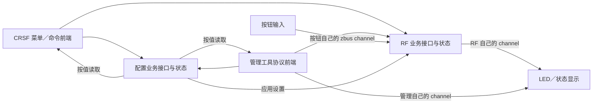

# System architecture

How the system is put together: what the two links do, how the bands mix, how the radio is
shared, how the timing budget is spent, how the code is layered and what the threading and
callback contracts are. Product: [01-product](01-product.md); platform:
[02-platform](02-platform.md); protocol: [08-protocol](08-protocol.md).

## 1. The two links

| Link | Default band | Modulation | Carries | Optimised for |
| --- | --- | --- | --- | --- |
| Control | sub-GHz | FLRC (or LoRa) | CRSF: channels down, telemetry up, pairing | distance and stability |
| Data | 2.4 GHz | FLRC | a passthrough byte stream | rate and throughput |

Each link runs its own copy of the same state machine, and they are **independent**: losing one
does not touch the other. They do share a radio, an MCU and a supply, so they are not redundant
links, only mutual backup against interference; a radio or supply failure takes both down.

There is no automatic band failover between roles at runtime: the band role is a build-time
choice (long range or racing), and the sub-band mix below is what adapts.

## 2. Bands and sub-band mixing

Each link has one **cross-sub-band hop table**: 2.4G and sub-G frequencies in the same table,
split by the mix ratio `r` (four levels: 0 / 25 / 50 / 100 %). The TX decides `r`, carries it
plus a table version in `SYNC`, and the RX adopts both while handling that frame, so nobody is
half on the old table. In essence it is "a frequency hop, just a bigger one", so no extra
rendezvous protocol is needed.

The two links time-share the radio and stay independent, each with its own `r`. A single-port
board carries one of them, chosen by configuration.

The migration order is fixed: **telemetry, then data, then the RC downlink**. `r` moves the
least critical traffic first and the RC last, so latency steps down instead of jittering.
Sync word derivation labels follow the link (`sync/control`, `sync/data`, `sync/pairing`) rather
than the band, so mixing leaves the key structure untouched ([09-security](09-security.md) 3).

**The regulatory gate only applies to sub-G slots**: 2.4G has no region table. The ceiling for
`r` comes from the regional duty cap (about 10 frames per second at EU868's 1 %), and going
over it clamps the tier and warns.

The superframe period follows the slower link: data windows amortise into every frame through
`data_every_n`, and the time plan works out how far that drags the control rate down.

## 3. Time sharing and scheduling

Both links share one radio owner on the link thread. USP supplies RAL, the LR20xx driver,
board support and its Zephyr HAL; RAC and the radio planner are not initialized or run.
Ordinary commands and FIFO transfers use that HAL and the Zephyr SPI driver. CMake registers
ZLRS's own sources and leaves upstream library source lists unchanged.

RP2350 TIMER1 runs at 1 MHz. Alarm 0 advances the four absolute slot boundaries and publishes
the latest frame; alarm 1 wakes the owner for preparation; alarm 2 ends the radio window and
publishes ordinary completion notifications. Alarm 3 issues the prepared five-byte `SET_TX`
from a RAM-resident zero-latency ISR, bypassing kernel interrupt locks. A delayed thread skips
expired slots and advances hop/frame state without building or transmitting old packets.
Frame snapshots consume any pending wake token under the same interrupt lock, and the owner
rejects an already consumed frame number. Management pauses radio work while the absolute clock keeps running, so missed frames can be
accounted for when it resumes. The superframe shape is in [08-protocol](08-protocol.md) 4.

The TX is the clock master. The RX follows authenticated packet timestamps captured by the
GPIO ISR, subtracting packet airtime and the TX launch offset. Corrections are bounded and
applied to a future frame boundary; only RX scans its phase when it has heard nothing.

Both links default to FLRC. Changing modulation (FLRC to LoRa) costs far more on the radio side
than changing frequency, so the data link always stays on 2.4G FLRC while the control link may
move to LoRa for range (`CONFIG_ZLRS_APP_CONTROL_MODULATION_*`, SF7 / BW125 / CR 4/5 by
default). The superframe then follows the slower link.

## 4. Timing budget and rate tiers

From LR2021 datasheet Rev 1.1 Table 3-23 (typical values); the full table is in
[05-radio](05-radio.md):

| Symbol | Meaning | typ |
| --- | --- | --- |
| `PLL_LOCK` | synthesiser lock | 32 us |
| `TSFSTX1` | FS to Tx | 45 us |
| `TSFSRX2` | FS to Rx (FSK/FLRC) | 37 us |
| `TSTXRX` | Tx to Rx | 91 us |
| `TSRXTX` | Rx to Tx | 107 us |
| `TSXORX` | STDBY_XOSC to Rx | 84 us |
| `TSXOTX` | STDBY_XOSC to Tx | 76 us |

One "transmit on sub-G, receive on 2.4G" switch costs about `Tx->FS(54) + PLL(32) + FS->Rx(37) =
123 us`, roughly 250 us for the round trip. At a 150 Hz control rate (6.67 ms per frame) that is
about 3.7 %.

The front end follows the frequency automatically: `ral_lr20xx_bsp_get_rx_cfg()` picks the HF
path at `freq >= 1.6 GHz` and the LF path otherwise, so all we do is fill in a frequency.

### Rate tiers

| Tier | FLRC raw rate | Effective rate (CR 3/4) | Used for |
| --- | --- | --- | --- |
| Close-in, fast | 2.6 Mbps | 1.95 Mbps | 2.4G slots (control at `r=0` and the data link) |
| Balanced | 1.3 Mbps | 0.975 Mbps | the control link while mixing bands |
| Long range | 0.65 Mbps | 0.488 Mbps | the control link stepping down |
| Floor | 0.325 Mbps | 0.244 Mbps | narrow-band regions |

LoRa is the tier below those: SF5-12, BW 125/250/500 kHz, CR 4/5-4/8, at tens of milliseconds per
frame. The previous approximately **97 kB/s** estimate was an airtime-only target, not measured
throughput. The current implementation has four equal slots and one packet per data direction
per frame. Its timer period includes native packet airtime, preparation guard and RF startup;
LF is clamped from the configured preparation window and RF budget. The maximum CRSF service
frame also contributes to that budget; the current LF CN433 mixed plan runs at approximately
24 Hz. ARQ confirmation and queue availability further affect payload delivery. Product control
rate targets require a new measured budget and schedule; pending work is tracked in
[12-roadmap](12-roadmap.md). Measurements belong with their test artifacts.

## 5. Software layering

```
include/zlrs/proto/    protocol core headers (frame, hop tables, telemetry, crypto)
core/proto/            protocol core: framing, hop tables, key derivation, tags, airtime model
core/link/             link layer: state machine, pairing and sessions, reliable transfer
core/crsf/             CRSF framing, channel/statistics codecs and device/parameter protocol
core/mgmt/           management protocol: framing, command dispatch, status encoding
core/region/           region tables, power and duty limits, the control time plan
include/zlrs/          public headers for everything in core/
subsys/usb/            USB device stack: usbd context plus every CDC in devicetree
subsys/bootguard/      bootloader-side watchdog handling
drivers/entropy/       the RP2350 TRNG driver we own
app/src/               Zephyr application, one directory per layer:
  main.c                 entry point
  runtime/               startup assembly, management maintenance sessions,
                         image confirmation/rollback and delayed reboot
  rf/                    links, air transports, superframe, pairing/session, rate/power,
                         maintenance and copied RF diagnostics
  crsf/                  serial.c: UART/CDC parser, queues and single-wire timing
                         crsf.c: routing, RC freshness, reports and protocol frontend
  data/                  byte endpoints, rings, endpoint selection and whole-packet admission
  config/                validated saved/active settings, identity, pairing persistence;
                         nvs.c is private storage
  mgmt/                  management CDC, session, wire commands/replies and error mapping
  ui/                    button gesture/channel, LED consumer and pure pattern renderer
  platform/              hardware capabilities, SHA, timer, radio, watchdog and recovery
  storage/               flash log ring
boards/                board definitions (devicetree, defconfig, README)
dts/bindings/          bindings for ZLRS-specific nodes
tools/                 workspace setup, management, recovery and firmware update tools
tests/                 host/module tests, hardware test applications and data measurements
tests/host/            host build of core/ plus the two-node radio simulation
```

The rule: the protocol core and the link layer build and run on the host using the same `core/`
sources. `core/proto/crypto.c` owns HMAC, HKDF, PBKDF2 and the protocol derivation rules.
Its private `sha256.h` declares one SHA operation over two input spans: firmware supplies it
through `app/src/platform/sha256.c` and Zephyr's Crypto API; host tests supply it through
`tests/host/sha256_soft.c`. This is a fixed link-time dependency, without a runtime backend
table or platform context. `core/` includes no Zephyr headers, and `app/` never branches on a
board name — both are CI gates (`tests/gates.sh`, see
[11-debug](11-debug.md#7-tests-organized-by-module) for commands).

The application binds directly to Zephyr and RP2350. `crsf/serial.c`, `data/data.c` and
`mgmt/mode.c` own their respective UART/CDC devices and queues. `platform/radio.c` uses the
USP RAL / LR20xx driver; `platform/slot_timer.c` uses TIMER1. `rf/rf.c` owns both link instances,
executes their radio requests and coordinates timing, policies and maintenance.

`main` delegates startup to `runtime/`, which initializes configuration, management, RF and
the serial frontends. Runtime passes copied boot capabilities to CRSF and owns image confirmation,
rollback, management sessions and delayed reboot. RF calls runtime hooks only at owner-thread
boundaries; RF keeps link and superframe timing. CRSF exchanges latest RC/TLM samples and complete reliable messages
with RF through functions; RF sees opaque service messages and has no CRSF codec dependency.
The CRSF adapter validates frames, routes them and encodes device/menu responses using the same
configuration and pairing business operations as management and buttons. All business calls
execute on the RF owner thread; interrupts/workqueues only operate on endpoint queues.

Before RF slots, CRSF checks channel freshness and computes Shot timing. After slots, it
processes bounded incoming requests. Completed actions retain a pending reply when output is
full, so retrying output does not repeat a configuration write or device command. Configuration
owns all NVS records and validates the complete saved region/power combination. Flash writes
enter a nestable RF maintenance window; resuming invalidates stale RC and prepared DATA packets
while retaining reliable queues and stream progress.

DATA admits a received air packet completely or refuses it. RF advances the receive sequence
and ACK toggle only after admission. There is no partially delivered prefix on retry. RF also
owns service-message ACK/retransmission independently of the user DATA stream.

RF, CRSF, DATA, configuration, management and the button define and publish their own channels.
Only copied status/events cross threads; frontends never obtain live link pointers or private
NVS records. UI reads producer headers and combines their facts. Publishers retry failed
publications and mark their cached value delivered only after success. Functions carry payloads
and business commands; zbus carries copied status and button counts. These boundaries are checked
by `tests/gates.sh`; the detailed contracts are in section 8.

USP supplies the transceiver RAL and Zephyr HAL. The application owns preparation,
calibration selection and launch scheduling.

Every transmission also passes a **regulatory gate**: `core/region` provides the region's
channel plan, power ceiling and duty cap; a slot with no budget left is given up and counted in
the log. See [08-protocol](08-protocol.md) 5.2.

## 6. Threading model and callback contract

### 6.1 Threads

| Thread | Priority | Responsibility |
| --- | --- | --- |
| Link thread (`main`) | highest cooperative priority, meta-IRQ in data24; `-2` otherwise | link state machines, radio preparation/completion, system state broadcast; management temporarily uses `-2` |
| USB core / controller | upstream cooperative priorities | USB events; vendor source and scheduling are unchanged |
| LED thread (`zlrs_led`) | `7` (preemptive) | renders the system state it subscribes to and writes the WS2812 (`app/src/ui/led.c`) |
| Button thread (`zlrs_button`) | `8` (preemptive) | samples the button, reports a hold on the bus (`app/src/ui/button.c`) |
| Serial | hardware ISR or upstream CDC workqueue | ring-buffered transfers, no radio decisions |
| Serial notifications | system workqueue | enables peripheral TX/RX outside the RF thread |

The link thread owns radio preparation and completion. Data24 resumes at DMA, radio and timer
events even when a cooperative USB worker is active. Serial peripheral notifications use the
system workqueue; CDC callbacks remain the only callers of CDC FIFO operations. Only the
prepared TX command is handed to alarm 3; the owner waits without touching SPI until the ISR
publishes its SRAM result and alarm 2 wakes it. `CONFIG_USP_MAIN_THREAD=n` and
`CONFIG_LORA_BASICS_MODEM_DRIVERS_EVENT_TRIGGER_NO_THREAD=y`: the GPIO callback only timestamps the IRQ and
wakes the owner, which reads status and completes the link transaction. Serial work is bounded
between frames. Flash operations can still delay IRQ handling; delayed boundaries are counted
and the absolute schedule is preserved.

The LED thread keeps the PIO push and WS2812 latch delay out of radio work. It runs while the
link thread is blocked and pushes a frame only when the colour changes.

Each producer defines its channels in its own module. Consumers decide how to display the
facts. The communication rules are:

- a publisher writes only when the message changed, so the bus carries events, not a heartbeat,
  and the LED thread's own 20 Hz tick drives the blink phase;
- what the user asked for rides the same bus (a hold of the button), so the link state machine
  stays on the link thread while the button thread owns the timing;
- every channel has one owner, because a publisher writes the whole message: two writers on one
  channel would each blank the other's field;
- RF publication uses `K_NO_WAIT`, so the superframe never waits for a consumer; a failed
  publication must retain its retry opportunity rather than mark the value as published.

The LED consumer decides how to display those facts — colours, cadence and priority are implemented
in `app/src/ui/led.c`. Producers remain independent of display choices. See [10-ux](10-ux.md).

Management mode runs on the same owner thread: RF stops submitting radio transactions,
temporarily uses ordinary thread priority and runs the management session. On exit it invalidates
old control input and finishes confirmation/log persistence before resuming RF (see
[07-firmware](07-firmware.md) 2).

### 6.2 Callback contract

The radio GPIO callback records the TIMER1 timestamp, sets a pending flag and gives a semaphore.
It never reads SPI, validates a packet or submits another transaction. The link thread drains
the IRQ, reads the FIFO and invokes `zlrs_link_complete()`.

### 6.3 Integration constraints with USP

The application instantiates its own `ralf_t` from the chosen transceiver device, then calls
`ral_reset()` and `ral_init()`. It attaches the GPIO callback through the transceiver board API.
USP initialization of RAC, task submission and runtime backend switching are absent. Both links
share cached modem parameters and stay in standby/FS between transactions. Every TX clears its
FIFO before writing: an aborted packet must not contaminate the next packet.

The RP2350 build relocates the RF application's main, radio I/O, hardware crypto and portable
link/frame/hopping text to SRAM through Zephyr's code-relocation API. Core sources
remain platform independent; MCUboot still installs the signed Flash image, and startup copies
the selected text to SRAM. FIFO DMA uses two channels allocated through the public controller
API and a single RX-completion semaphore.

Slot execution has two stages. Before the nominal boundary, the link thread constructs and
authenticates the packet, configures the modem and frequency, loads the TX FIFO and enters FS.
It then waits for the hardware launch alarm. Only `SET_TX` runs at the configured offset;
receivers start listening as soon as their preparation finishes. The previous RX window ends
before this preparation reservation, so early FIFO loading never overlaps an active reception.
The frame alarm publishes the next frame early; protocol decisions still use the planned slot
time and phase correction is included when calculating the final slot deadline. In connected
data24, a TX can build and preload immediately after the preceding reception completes; RX
entry still waits for its own preparation boundary. Searching and pairing keep that boundary.

The final prepared TX command runs in the RAM-resident alarm 3 ISR. It uses only TIMER1,
GPIO and PL022 registers plus its SRAM mailbox, with a 50 us bounded polling transfer. It
calls no kernel, RAL, DMA or logging API and can preempt USB interrupts and kernel IRQ locks.
The HAL uses polling for short configuration/status commands and DMA for FIFO data. Alarm 3 is armed only
after those transfers finish; the owner performs no SPI access until launch completes. The
ISR checks BUSY and controller state before asserting CS and rejects a trigger over 100 us
late. Alarm 2 performs the subsequent kernel notification. Authentication, configuration,
FIFO access, IRQ draining and protocol callbacks stay on the link thread.

The RAL initializes extended 1024-byte FIFOs, which hold the maximum 511-byte zlrs frame.
RX reads the complete packet only after `RX_DONE` and modem CRC validation; the link then
checks its authentication tag. RX threshold interrupts are disabled so an intermediate
FIFO event cannot hide the completion edge or supply an earlier phase timestamp.

The board calibration table contains exactly three entries because the vendor BSP consumes
three; HF pads its unused entry with zero, and LF includes both sub-G coverage and 2.4 GHz.

## 7. Diagnostics

Diagnostics **add no extra channel**: link quality rides the existing CRSF link statistics frame
(`0x14`, see [08-protocol](08-protocol.md) 2.4). The data link's overflow and dropped bytes have
no CRSF field to travel in, so they are counted and exposed through the management protocol's
`STATUS` response instead. Debug images can additionally print a 1 Hz `stats:` / `air:` line
(`CONFIG_ZLRS_APP_DEBUG_STATS_LOG`).

Management debug reports are formatted in `app/src/rf/diagnostics.c`. At the start of a
report, the RF owner copies link observations and scheduling measurements into a snapshot;
subsequent chunks read the cached text. Formatting never borrows mutable link storage, and
the snapshot is captured only on request, outside the radio hot path.

## 8. 模块职责与通信

本节描述当前的模块边界和通信契约。
同一功能可以有 CRSF、管理工具、按钮等多个前端，功能的规则和状态由业务 owner
统一实现。模块可以包含多个实现文件，模块划分不决定线程数量。

### 8.1 六个业务模块

| 模块 | 自己拥有的职责与状态 | 通信边界 |
| --- | --- | --- |
| RF | 两个链路实例、配对／会话／ARQ、调度／相位、速率／功率策略、radio 事务、暂停／恢复、实际运行参数 | 对多个前端提供相同的配对／取消、运行参数应用和查询接口；接纳 RC／不透明可靠消息／DATA，发布自己的状态 |
| CRSF | CRSF UART／USB 端点、单线时序、解析／路由、设备发现／菜单前端、RC 新鲜度、遥测／Shot、串口速率协商、相关队列 | RC／帧通过函数与 RF 交换；设备菜单与命令转换成共用业务接口调用，协议值从业务状态生成；发布自己的端口与输入状态 |
| DATA | DATA UART／USB 端点、端点选择、输入／输出队列、背压和串口丢字节计数 | 字节流通过函数与 RF 交换；发布自己的端口、背压和丢字节状态 |
| 管理 | 管理 CDC、协议解析／回复、管理会话、设备管理前端和错误码映射 | 与 CRSF 共用配置、配对和设备操作接口，固件／日志操作调用实际负责的实现；发布自己的会话状态 |
| 配置 | 配置业务的默认值、组合校验、生效／持久化规则、身份与保存记录、期望值、待生效标记和版本 | 对多个前端提供相同的读取／修改接口，协调所属模块应用设置；发布自己的配置变化与待生效状态 |
| UI | 按钮 GPIO／消抖／手势、LED GPIO／显示优先级／颜色／节奏 | 按钮发布自己的输入 channel；RF 在 owner 线程接收请求；LED 直接订阅各业务模块的状态 |

`runtime/` 负责初始化与装配、管理会话维护窗口、镜像确认／回滚和延迟重启。Zephyr／RP2350、USP radio、slot timer、SHA、entropy、
watchdog、MCUboot 和日志介质是具体硬件支撑；模块按实际需要直接调用。
CRSF／DATA 的 UART／USB 和 ISR 队列归各自模块，不重复交给平台层管理。
配置的 NVS 实现可以作为配置模块的内部文件，不额外增加只转发读写的公共层。
`core/` 保留纯 C 算法和协议实现，它们是上述模块的内部依赖，不再构造第二套业务服务。

配置拥有“准备使用什么”，RF 拥有“当前正在使用什么”。菜单和管理查询使用同一配置
来源，明确区分保存值、运行值和需要重启的修改。临时模型选择与保存模型设置是两种
业务动作。协议入口负责解释请求与编码回复，校验及生效规则由对应业务 owner 决定。

### 8.2 多前端共用业务抽象

抽象的是设备功能：函数执行完整业务动作，前端不重复实现规则，也不直接获得
`zlrs_link_t *`、NVS key 或内部可写状态。接口声明在业务 owner 的模块头中，
实现和状态放在该模块内；这些接口不是集中转发一遍现有调用的“统一命令服务”。

| 共用功能 | 业务 owner | 多前端共同使用的操作 |
| --- | --- | --- |
| 配置／模型／遥测开关 | 配置，RF／CRSF 执行对应运行设置 | 读取、校验候选组合、临时应用或持久化修改、查询生效结果 |
| 配对 | RF | 开始、取消、查询进度和结果；按钮、CRSF 菜单和管理命令复用相同规则 |
| 端点／速率协商 | CRSF 或 DATA | 对实际端点提出变更，查询能力与结果；物理条件由端点 owner 判断 |
| 暂停／恢复 | RF | 请求维护窗口、查询暂停完成、恢复并失效过期输入 |
| 重启／恢复／镜像确认 | 启动与固件相关实现 | 请求、取消或查询；协议前端不自行维护另一套设备操作状态 |

例如 CRSF 菜单和管理命令都将区域／功率请求转换成同一个配置修改操作。业务实现
校验完整组合、决定保存及生效方式，返回结果；两个前端分别编码 CRSF 回复和管理 ACK。
CRSF 参数编号、目的地址和管理命令号留在前端，共用接口使用业务类型与业务错误。
动作执行与回复发送解耦，回复队列背压只重试回复，不能重复执行已完成动作。



CRSF 内部按通道／遥测交付、设备管理前端、UART／USB 时序组织实现。
设备业务规则放在共用接口后，CRSF 前端负责协议差异；整体仍属于六个模块。

### 8.3 各模块拥有自己的 bus

channel 随产生状态的模块放置，消息类型和 `ZBUS_CHAN_DECLARE` 在该模块的头文件中，
`ZBUS_CHAN_DEFINE` 与发布操作在该模块的实现中。模块只定义需要通知的 channel，
无需为了形式给每个模块都增加一套 bus 文件。

| channel 的归属 | 产生的事实 | 典型消费者 |
| --- | --- | --- |
| RF | 工作链路的状态／质量、故障、RC 可交付状态、空中丢弃计数 | UI、管理、CRSF |
| CRSF | 端口状态、最新输入是否有效、解析／队列错误 | RF、UI、管理 |
| DATA | 端口／背压状态、串口丢字节计数 | UI、管理 |
| 管理 | 会话打开／关闭 | UI |
| 配置 | 保存值／当前值、配置版本、需要重启 | CRSF、管理、UI |
| UI 按钮 | 手势计数或输入事件 | RF |

消费者包含生产模块的消息头，直接使用 `zbus_chan_read`、subscriber／observer；
生产者直接使用 `zbus_chan_pub`，没有集中 bus 注册中心或同义发布包装。
现有 API 的名称不必为重构机械调整；新增公共函数应承担具体业务或状态管理。

每个 channel 一个发布者。状态可合并为最新值，不可丢的事件明确使用计数或队列；
生产者处理发布失败并保留重试机会。消息按值复制，不携带链路指针或借用缓冲区。
UI 自己组合各模块的状态用于显示，不需要中间的“系统状态聚合服务”。

### 8.4 函数调用与 bus 的分工

| 通信内容 | 方式 | 必须明确的契约 |
| --- | --- | --- |
| RC 最新样本 | CRSF ↔ RF 函数调用 | 时间戳、有效期、模型／端点切换后的失效规则，旧样本可覆盖 |
| 不透明可靠消息（当前由 CRSF 使用） | CRSF ↔ RF 函数调用 | 整帧接纳或拒绝、满队列时发送方保留、接纳后才确认 |
| DATA 字节流 | DATA ↔ RF 函数调用 | 发送侧报告接纳字节数；可靠接收侧整包接纳后才推进 ARQ／ACK，拒绝时不能丢弃或重复交付部分前缀 |
| 配置、配对、暂停／恢复 | 多前端调用共用业务接口 | 业务类型与错误、接纳／完成、生效时机、失败和取消；跨线程请求在 RF owner 的安全边界处理 |
| 运行状态、配置变化、按钮输入 | 所属模块的 zbus channel | 发布者、消息寿命、合并／满载策略和失败处理 |
| 外设／NVS 操作 | Zephyr／现有具体实现函数 | 谁访问外设，以及 flash 操作所需的 RF 暂停／维护窗口 |

CRSF／DATA 的业务处理与 RF 默认保留在同一个 owner 线程，ISR／USB workqueue 只处理
端点和有界队列，LED／按钮保持现有线程。不通过 zbus 逐字节或逐包广播实时数据。
listener 不执行 flash 或长任务；存储操作经 RF 暂停／维护窗口协调执行。

速率、功率、混合频段策略归 RF，诊断读取其结果。radio 准备、IRQ／FIFO、定时器触发
作为 RF 的具体实现保留，直接使用 USP／Zephyr 公开 API，不增加 ports 抽象或通用 ops 表。

### 8.5 验证边界

模块职责变更保留当前线格式。性能改造按独立预算与产品验收目标推进。
验证以 LF／HF 构建、实际两板和外部设备用例为主。host 测试可选且尽量薄；
保留必要的协议检查，不为覆盖应用引入虚拟硬件后端或第二套运行时。
LF／USB 板间测试和实际遥控器／飞控 UART 互操作分别报告。
未完成验收仅在 [12-roadmap](12-roadmap.md) 维护。
