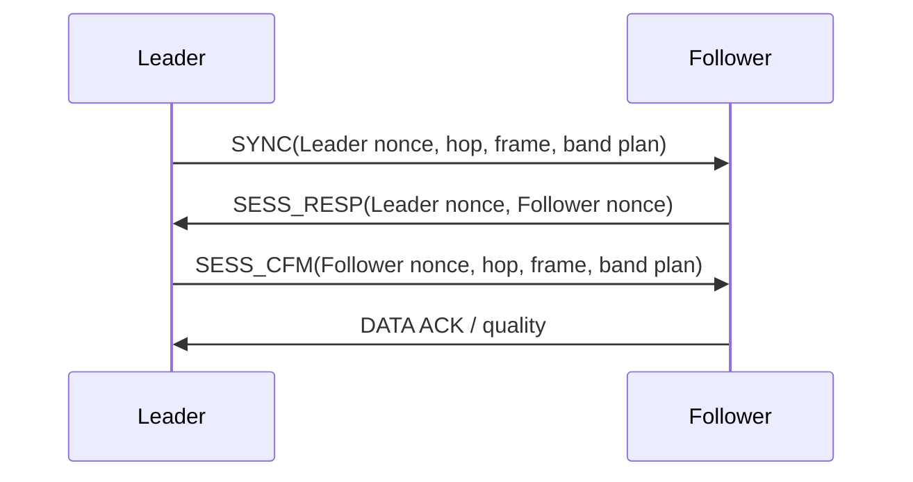

# Air and management protocols

This specification defines air protocol version 12 and USB management version 5.
Peers require matching air version, band mode, SubG region, security profile and
timing. Identity, key derivation and trust boundaries are specified in
[security](08-security.md); service ownership in [architecture](05-architecture.md).

## Air frame format

```text
TYPE / type-specific first-byte fields | SEQ(u32) | TYPE BODY | TAG
```

All integers wider than one byte use little-endian encoding. The radio supplies
preamble, synchronization word, packet length and physical CRC; these are outside
the software frame. Software frames have a five-byte common prefix: one first
byte and four sequence bytes.

The first byte assigns bits 0–2 to the eight message types. For SYNC, bit 3 is
profile and bits 4–7 are version. For every other type, bits 3–7 must be zero.
SYNC declares version 12 and profile P0=0 or P1=1. A P1 SYNC starts with `0xCA`.
The receiver selects tag length from its local profile and rejects a mismatching
SYNC profile; untrusted input cannot downgrade authentication.

P1 appends the first four bytes of HMAC-SHA256 over the exact first byte,
sequence and encoded body. P0 appends no tag. The first-byte version/profile
fields belong to SYNC; ACK, application length, identities and nonces are
message-specific fields.

### Logical frame model

One frame owns a type-selected union of bodies, with common sequence and tag
outside the union. Only identical layouts share a body:

| Body | Fields |
| --- | --- |
| DATA_L2F / DATA_F2L | ACK:1, DATA sequence:7, RSSI:u8, LQ:u8, owned DATA byte array |
| SYNC | Profile:1, version:4, hop:u8, Leader nonce:u32, TDD frame index:u32, band plan |
| PAIR_REQ | Initiator ID:4 bytes, initiator nonce:u32 |
| PAIR_RESP / PAIR_CFM | Initiator ID:4 bytes, responder ID:4 bytes, both nonces:u32 |
| SESS_RESP | Leader nonce:u32, Follower nonce:u32 |
| SESS_CFM | Follower nonce:u32, hop:u8, TDD frame index:u32, band plan |

DATA and tag are owned byte arrays. DATA capacity is 503 bytes; its used length
comes from the total radio payload length supplied outside the frame model.
Bodies do not repeat the common sequence. Encoding selects only the active
body's fields and used DATA bytes, independently of memory alignment or compiler
bitfield layout.

### Wire bodies and lengths

The body column starts after the five-byte common prefix. SYNC version/profile
are already encoded in the first byte. Total lengths are software radio payload
bytes, including the tag and excluding physical radio framing.

| Type | Value | Body in wire order | P0 total | P1 total |
| --- | --- | --- | ---: | ---: |
| DATA_L2F | 0 | ACK/sequence(1), RSSI(1), LQ(1), DATA(N) | 8+N | 12+N |
| DATA_F2L | 1 | ACK/sequence(1), RSSI(1), LQ(1), DATA(N) | 8+N | 12+N |
| SYNC | 2 | Hop(1), Leader nonce(4), frame index(4), radio plan(6) | 20 | 24 |
| PAIR_REQ | 3 | Initiator ID(4), initiator nonce(4) | 13 | 17 |
| PAIR_RESP | 4 | Initiator ID(4), responder ID(4), initiator nonce(4), responder nonce(4) | 21 | 25 |
| PAIR_CFM | 5 | Initiator ID(4), responder ID(4), initiator nonce(4), responder nonce(4) | 21 | 25 |
| SESS_RESP | 6 | Leader nonce(4), Follower nonce(4) | 13 | 17 |
| SESS_CFM | 7 | Follower nonce(4), hop(1), frame index(4), radio plan(6) | 20 | 24 |

Fixed bodies require exact lengths. DATA length is:

```text
P1: DATA length = total length - 12
P0: DATA length = total length - 8
ACK/sequence byte = (DATA sequence << 1) | ACK
```

P1 carries at most 499 DATA bytes and P0 at most 503; both maximum frames are
511 bytes. N=0 returns ACK and quality without user data. A 20-byte user payload
produces a 32-byte P1 frame. There is no application size, padding or end-position
field. Packets use the bytes available without waiting for a full frame; short
packets reduce airtime but retain fixed slot boundaries.

## Sequence, delivery and quality

| Counter | Meaning | Progression |
| --- | --- | --- |
| Common `seq` | Transmission attempt within a pairing/session context, per direction | Strictly increasing u32; retries receive a fresh value |
| `data_seq` | One outstanding user DATA packet, per direction | Modulo 128; retries keep the same value and bytes |
| `frame_index` | Shared TDD period number, including idle periods | u32; used by SYNC, confirmation and transition plans |

Common sequences begin at 1. Zero denotes an absent receive baseline and is not
transmitted. Each direction maintains a continuous counter from its session
handshake through connected traffic. Confirming a key or entering CONNECTED
cannot reset that counter. A context cannot wrap or reuse a sequence; exhaustion
requires a fresh nonce context before further transmission. Pairing has its own
context and continuous per-direction counter for its three message types.

A preliminary sequence check is read-only. Direction, receive state, identity,
nonce, authentication and the applicable baseline must all pass before advancing
that baseline or changing ACK, quality, clock or delivery state. Pairing,
candidate handshake and confirmed session contexts are distinct. A greater
sequence alone cannot install a session, and a peer restart cannot be rejected
solely against the old DATA baseline.

Each direction retains one outstanding DATA packet. The ACK bit is the parity of
the receiver's next expected DATA sequence, initially zero. The sender removes
its packet only when valid reverse feedback carries the corresponding ACK.
The receiver advances DATA acceptance only after its sink accepts the whole
packet. A repeat is not delivered twice; a full sink retains backpressure.
Timeouts retry the same packet without discarding stream progress. A prepared
packet carries its captured ACK; DATA accepted after preparation leaves another
ACK pending. ARQ-disabled debug operation uses the same frame layout.

RSSI is the magnitude of negative dBm, 1–255; zero means unavailable. LQ is an
integer percentage 0–100. These describe the sending endpoint's reception of
its peer. Local RSSI comes from accepted radio packets; peer RSSI/LQ comes from
valid reverse DATA, including empty feedback frames. Idle quality feedback is
scheduled at 250 ms intervals, subject to slot and duty availability.

LQ counts accepted confirmed-session DATA, same-session SYNC and valid session
confirmation. Sequence gaps estimate expected transmission attempts. A window
closes at at least 128 expected attempts; 128/128 is 100%, 127/128 is 99%.
Tracking remains continuous across window boundaries. Pairing and candidate
handshakes do not contribute to the DATA-quality denominator. LQ is an observed
sequence-span metric, not an end-to-end delivery percentage.

## Pairing and sessions

Pairing opens for 30 seconds and repeats requests every 100 ms. Leader initiates and
Follower responds. Automatic mode pairs on 2.4 GHz; fixed mode pairs on the selected
band. Pairing uses hardware sync word 2, ASCII `ZLRS`.

PAIR_REQ binds the initiator ID and nonce. Follower identifies a request by both fields;
a duplicate reuses its pending responder nonce, while a changed ID or nonce
requires a fresh response. PAIR_RESP and PAIR_CFM bind and echo both IDs and both
nonces. Repeated valid confirmation is idempotent. Equal device IDs cannot form a
pair. The peer ID and pairing nonces are saved; no key travels over the air.

Sessions use three messages in both P0 and P1:



Leader nonce selects its pending challenge; Follower contributes fresh randomness.
SESS_RESP is accepted only in that pending context. Follower enters CONNECTED only
when SESS_CFM verifies with the candidate directional session key and expected
Follower nonce. Repeated exchanges preserve confirmed DATA progress. A response with
a different Follower nonce after an established exchange can prompt a new Leader challenge,
but cannot directly reinstall a key or reset ARQ.

PAIR messages use the root-derived pairing authentication key. SYNC and
SESS_RESP use directional pairing-level authentication keys. SESS_CFM uses its
candidate session key and DATA its confirmed directional session key. A peer
reboot requires a new session handshake; a band-only change preserves the session.
Secure randomness must report failure, and failure blocks new proofs. Zero is a
valid nonce; a new local round must differ from the preceding local nonce.

## TDD timing and frequency hopping

Each period contains slot A (0, Leader → Follower) and slot B (1, Follower → Leader). Leader owns the clock;
Follower follows valid packet timestamps. DATA and session traffic use hardware sync
word 1 derived from pairing material.

The pairing seed creates deterministic equal-visit channel blocks. Each block
reserves its first position for the middle synchronization channel and shuffles
the remaining positions. Hopping advances for each DATA slot, including idle or
skipped slots. Invalid received hop indices are rejected.

| Domain | ID | First channel | Spacing | Channels | Hop-table entries |
| --- | --- | --- | --- | ---: | ---: |
| FCC915 | 0 | 902.5 MHz | 500 kHz | 50 | 250 |
| EU868 | 1 | 863.25 MHz | 500 kHz | 13 | 247 |
| CN470 | 2 | 470.3 MHz | 300 kHz | 96 | 192 |
| CN433 | 3 | 433.3 MHz | 300 kHz | 5 | 255 |
| ISM2400 | 4 | 2402 MHz | 1 MHz | 79 | 237 |

An eight-bit hop field covers all indices. `frame_index` supplies period alignment
and is independent of replay sequences.

Leader and Follower are endpoint roles. Both endpoints transmit and receive;
TX/RX denote operations and counters, not endpoint names.

Periodic SYNC defaults to five seconds in fixed mode; automatic mode caps it at
one second to announce PHY downgrades before reception is lost. It is rounded down to a whole number of actual
periods with a minimum of one. Pacing affects that conversion. Acquisition SYNC
repeats every 100/150/300/600 ms for raw rates 2.6/1.3/0.65/0.325 Mbps. Periodic
synchronization, acquisition and pending plans use the fixed sync channel.
LoRa acquisition SYNC repeats every 300 ms.

Slots reserve maximum-frame airtime and preparation: 2.5 ms for 2.4 GHz and 6 ms
for SubG, plus a fixed 200 µs launch guard, startup and completion margins.
Short packets cannot open the next slot early. Failed preparation cannot launch
late. Actual packet length determines transmit airtime and SubG duty charge;
exhausted duty budget defers transmission. See [radio requirements](04-radio.md).

Follower estimates the sender's packet start from IRQ completion time minus airtime.
It corrects phase with a 100 µs deadband and a per-step limit of one-sixteenth of a
period. Locked operation rejects large delayed-IRQ outliers. Fresh capture
accepts large valid offsets within its correction limit. After acquisition,
phase scanning waits through two periodic SYNC intervals without valid reception.
Peer-restart acquisition discards the previous phase-lock samples.

## Automatic band switching

Automatic mode starts on 2.4 GHz with the configured compatible SubG region as
fallback. Fixed modes do not search other bands. Pairing suspends automatic
search. Both endpoints must agree on automatic/fixed mode and active domain.

### Authenticated plan

Leader alone publishes coordinated plans. SYNC and SESS_CFM carry six bytes:

| Bits / bytes | Meaning |
| --- | --- |
| First byte, bits 0–2 | Current domain, 0–4 from the domain table |
| Bit 3 | Automatic mode |
| Bit 4 | Target band: 0 is 2.4 GHz, 1 is SubG |
| Bits 5–7 | Reserved, zero |
| Next four bytes | Little-endian u32 `switch_frame`; zero means no pending plan |
| Final byte, bits 0–2 | Current 2.4 GHz PHY profile; zero on SubG |
| Final byte, bits 3–5 | Target 2.4 GHz PHY profile; zero for target SubG |
| Final byte, bits 6–7 | Reserved, zero |

A nonzero plan changes band or PHY profile at a future period no more than 65535
periods ahead of the carried frame index. Fixed mode cannot publish a transition.
Domain, current PHY and mode must match the receiving configuration. Invalid, stale or
unauthenticated plans cannot change replay baseline, clock or band.

Leader schedules the transition at least one periodic SYNC interval plus 500 ms
ahead. The first announcement uses a known periodic SYNC opportunity. Subsequent
announcements repeat on the synchronization channel; Follower follows that channel
while DATA and ACK continue before the transition.

Both endpoints finish the two slots preceding `switch_frame`, reserve a shared
12 ms guard before that last old period closes, cancel old radio work and change
modem, period, hopping table and allowed power. Old slots retain their original
deadlines. The target period starts on the new band and captures phase afresh.

Retuning preserves the shared period count, transmit sequences, replay baselines,
session keys, both DATA sequences, deduplication, unacknowledged packets and serial
queues. The new hopping table starts at its origin. Old-band quality observations
are cleared and power starts at the allowed ceiling.

### Policy and recovery

Fresh quality requires recent reverse feedback and available RSSI in both
directions. Poor quality means either direction has LQ below 95% or RSSI below
the current profile's boundary in [radio requirements](04-radio.md#automatic-24-ghz-profiles).
SubG retains its -95 dBm boundary. The Leader policy is:

| Condition | Action |
| --- | --- |
| Fresh poor 2.4 GHz quality in either direction | Both roles restore their local TX maximum before the next transmission |
| Poor 2.4 GHz quality continuously for 2 s at maximum, following post-boost reception and reverse feedback | Leader schedules the next more robust 2.4 GHz profile; after LoRa SF7, schedule SubG |
| Both LQ values at least 99%, RSSI at least 6 dB above the next faster profile's boundary, continuously for 60 s | Probe that faster profile |
| Healthy, fresh SubG feedback with both LQ values at least 99% continuously for 60 s | Probe 2.4 GHz LoRa SF7 |
| Healthy probe quality continuously for 5 s | Retain 2.4 GHz and finish probing |
| Probe cannot capture or becomes persistently poor | Resume fallback/search |

Stale or poor feedback restarts the healthy SubG interval; entering SubG alone
does not start an unconditional 60-second return timer. The thresholds are
product policy subject to RF calibration.

Power recovery precedes downgrade qualification even when the endpoint already
uses maximum power. Feedback timestamped before the recovery cannot start that
qualification. Both roles hold maximum while poor quality persists; a healthy
observation returns to normal power control. The existing reverse DATA RSSI/LQ
feedback communicates asymmetric degradation. Power recovery changes no wire
fields, session state, DATA sequence or replay baseline. Contact-loss searching
continues independently when usable feedback disappears.

Default contact loss is 1.5 seconds without confirmed-session reception. It
first tries the next more robust 2.4 GHz profile, then SubG; SubG restarts the
full 2.4 GHz ladder at FLRC 2.6 Mbps during contact-loss searching. Leader dwells
28 seconds and Follower four seconds per profile. Leader's dwell exceeds a
complete six-profile Follower sweep, preventing permanent synchronized misses. Acquisition
without capture uses that dwell limit; a preferred-band probe uses the contact
loss limit. Radio capture is separate from logical session validity.

During capture, user DATA transmission stops while SYNC and required session
handshake messages continue on the synchronization channel. Follower tracks valid
SYNC/confirmation timestamps and completes capture only when phase error is
within ±100 µs and the session is valid. Follower then sends reverse DATA ACK/quality;
Leader completes capture upon receiving valid reverse DATA. Receiving a short frame
alone cannot prove the phase required by maximum-length DATA.

Before seeing valid synchronization, Follower begins rapid phase scanning after 300 ms
of silence, stepping by one thirty-second of a period. After seeing valid
synchronization, scanning waits at least two acquisition-SYNC intervals plus one
period, with a 300 ms minimum, so it does not oppose normal correction. A captured
Follower answers each valid same-session SYNC with sync-channel reverse feedback,
allowing one-sided recovery.

Search preserves the session and queued DATA. Lost announcements, one-way loss,
staggered startup and peer reboot use the same capture path; reboot also requires
a fresh session. No usable band means continued bounded-dwell search with finite
queue backpressure and management access.

Duty budget survives band changes. Every SubG transmission, including probes and
control, is charged using actual airtime rounded up to milliseconds. For a duty
window W, contact-loss timeout is at least W+2 s, Follower dwell at least W+2 s and
Leader dwell at least 7(W+2 s), covering a full six-profile Follower sweep.
EU868 therefore uses 62-second loss/Follower dwell and 434-second Leader dwell.
Switching cannot reset that budget.

Management cancels an unexecuted plan and requires capture when a plan was pending
or pause duration reaches the contact-loss threshold. Short pauses without plans
retain capture and active band. Accepted DATA stays queued; USB backpressure and
UART overflow accounting remain in effect.

## USB management framing

```text
A5 5A | version(1) | command(1) | payload_length(1) | payload | CRC8(1)
```

Version is 5. Payload is at most 91 bytes and a full frame at most 97. CRC8 uses
DVB-S2 polynomial `0xD5`, initial zero, over version, command, length and payload.
This CRC detects corruption; local USB access is the trust boundary. Multibyte
management integers are little endian. ACK command `0x80` carries the original
command and status: 0 success, 1 parameter, 2 state, 3 storage, 4 unknown command.

| Request | ID | Payload / effect |
| --- | --- | --- |
| ENTER / STATUS / PAIR / ERASE_PAIR | `00` / `01` / `02` / `03` | No payload |
| SET_KEY_HEX / SET_PHRASE | `04` / `05` | 64 ASCII hex characters / 1–32 phrase bytes |
| BUILD / IMAGE_HASH | `06` / `07` | No payload |
| SET_BAUD | `08` | u32 baud |
| SET_REGION / SET_ROLE / SET_PROFILE / SET_BAND | `09` / `0A` / `0B` / `0C` | One byte |
| NEW_DEV_ID / EXIT / FACTORY_RESET / RECOVERY / CONFIRM | `0D`–`11` | No payload |
| LOG_INFO | `12` | No payload |
| LOG_READ | `13` | File index:u8, offset:u32, requested length:u8, at most 80 bytes |
| DEBUG_REPORT | `14` | Report:u8, offset:u16; debug images only |

Responses are ACK `80`, STATUS `81`, BUILD `82`, IMAGE_HASH `83`, LOG_INFO `84`,
LOG_DATA `85` and DEBUG_REPORT `86`. Build text is at most 32 bytes and image hash
is 32 bytes. LOG_INFO carries count:u8, newest index:u8, then file number:u16 and
size:u32 pairs. LOG_DATA echoes file index and offset before the bytes.
DEBUG_REPORT carries report:u8, offset:u16, total:u16 and at most 85 text bytes;
report IDs 0–3 mean link, rate, radio and power.

Successful ENTER follows radio pause and synchronous log flush. Repeated ENTER
flushes again. The session exits on EXIT or 300 seconds of inactivity. Command
semantics and accepted settings are specified in [firmware](06-firmware.md).

## Management status

STATUS_RESP is 91 bytes, extending the original 90-byte response by one PHY byte.
The host also decodes legacy 90-byte status with unavailable PHY information,
so rollback to an older confirmed image remains observable. Power values are signed eight-bit dBm, RSSI and
temperature are signed 16-bit values, and counters are u32.

| Offset | Bytes | Field |
| --- | --- | --- |
| 0 | 4 | Management version, role, link state, flags |
| 4 | 8 | Device ID, peer ID |
| 12 | 4 | Local LQ, SubG hardware SKU, saved region, active-band maximum power |
| 16 | 4 | Saved UART baud |
| 20 | 1 | Active profile |
| 21 | 4 | Local RSSI, peer RSSI; zero means unavailable |
| 25 | 3 | Peer LQ, active power setpoint, effective floor |
| 28 | 2 | MCU die temperature, 0.01 °C; `INT16_MIN` means unavailable |
| 30 | 32 | TX frames, RX frames, CRC errors, authentication errors, ARQ retries, DATA drops, missed slots, radio failures |
| 62 | 4 | Current FHSS schedule frequency, Hz |
| 66 | 2 | Hop index |
| 68 | 4 | Frame period, µs |
| 72 | 2 | LR2021 junction temperature, 0.01 °C |
| 74 | 2 | LR2021 XOSC-area temperature, 0.01 °C |
| 76 | 2 | LR2021 VBAT, mV |
| 78 | 2 | LR2021 version major, minor |
| 80 | 3 | Chip mode, last command status, reset source |
| 83 | 1 | Sensor/status validity bits |
| 84 | 2 | Latched chip error mask |
| 86 | 4 | IRQ mask at the maintenance boundary |
| 90 | 1 | Active modulation profile ID from the radio profile table |

Flags: bit 0 root key, bit 1 pairing, bit 2 valid session, bit 3 active SubG,
bit 4 automatic mode, bit 5 acquisition, bit 6 pending plan, bit 7 debug fixed power.
Roles are Leader=0/Follower=1. States are unconfigured=0, unpaired=1, pairing=2, searching=3,
connected=4. Hardware SKU is LF=0/HF=1. Acquisition can coexist with CONNECTED and
a valid session; those flags do not prove DATA is ready.

Validity bits identify junction temperature (0), XOSC temperature (1), VBAT (2),
version (3), mode/command/reset/IRQ (4) and chip errors (5). Unset means unavailable,
even when the value is zero.

Radio sensors refresh at boot and management status while the RF owner is paused.
Mode and IRQ describe the stopped maintenance boundary; standby XOSC is expected.
Reads do not clear latched errors, IRQs or reset information. Temperatures use the
chip's 13-bit ADC unit format, signed Q8.5 converted to hundredths of a degree.
MCU and chip sensors measure internal temperatures, not ambient temperature.
The schedule frequency can differ from the fixed periodic-SYNC channel.

The debug shell reads copied observations without SPI or RF pause and displays
the radio sample age. Sensor observations must remain separate from live link
quality. Validation requirements are in [development and acceptance](10-debug.md).
